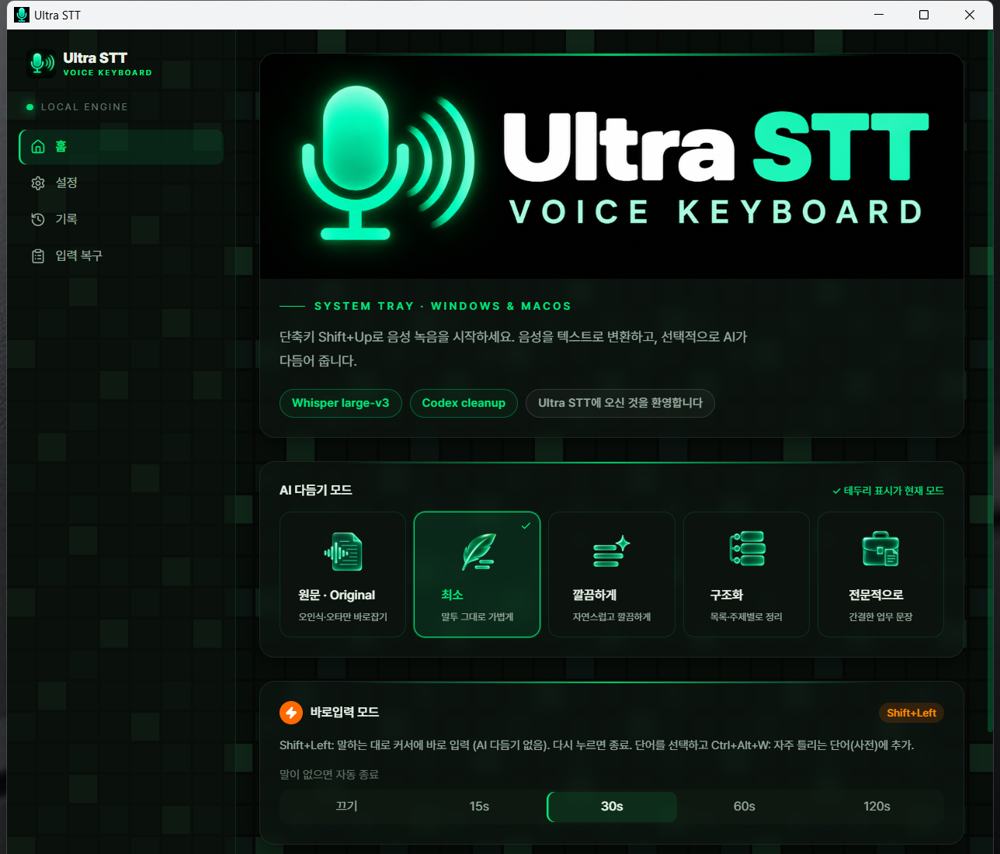
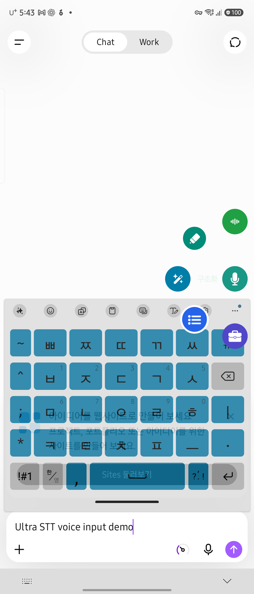
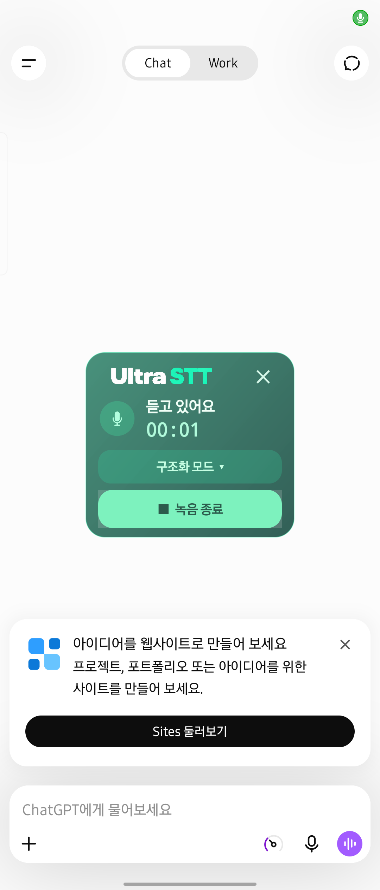
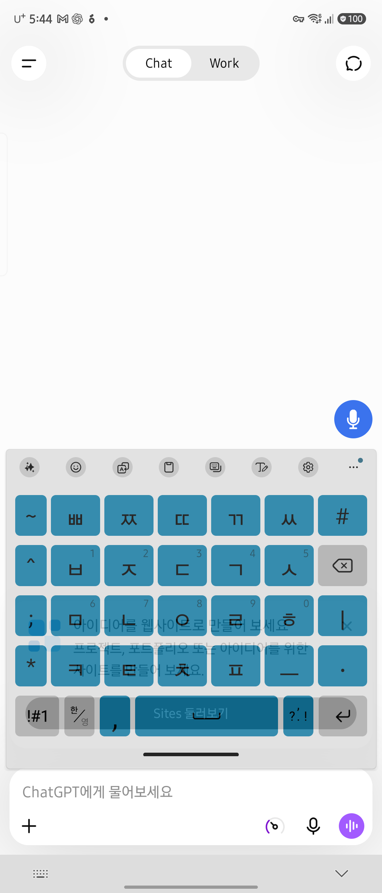
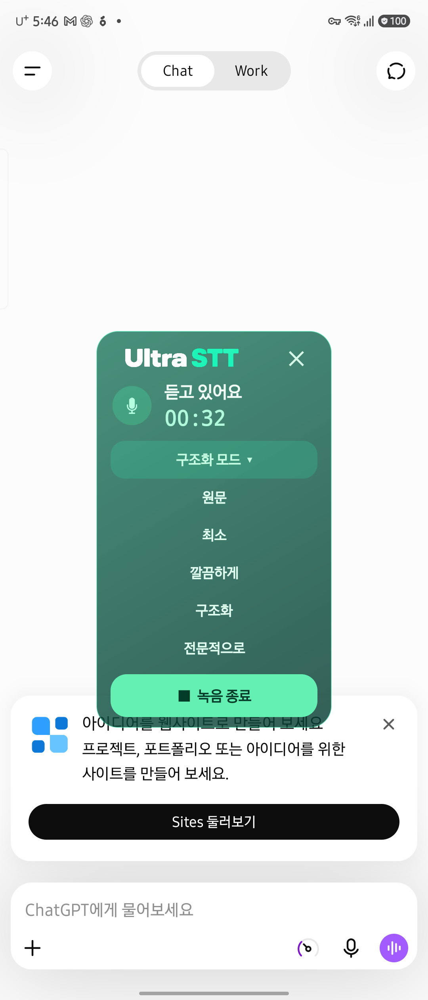
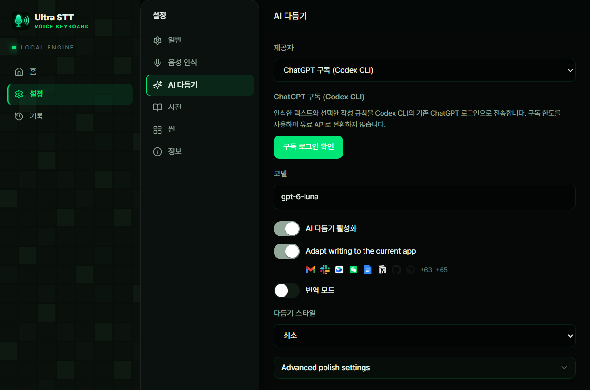
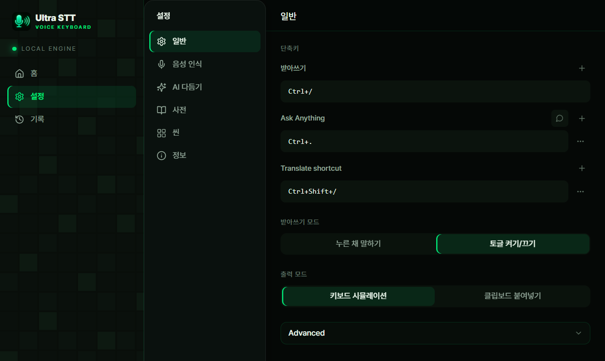

<p align="center">
  
</p>

<h1 align="center">Ultra STT</h1>

> **October 29 update:** Desktop **1.1.73 is installed on SB, Home and Mac**, and **1.1.73-android.14 on Fold7**. Settings offers two large STT engine cards, explicit API-key saving with a locked saved state, and connection tests. Desktop cleanup offers three GPT models and two local Claude Code models; Grok 4.7 remains disabled pending safe CLI support. Mobile keeps its OpenAI API workflow. Existing settings, authentication, history and recovery audio are preserved. GitHub downloads are unchanged. [Setup, routing and verification limits](docs/2026-10-29-model-selection-and-key-status.md) · [Mobile drag verification](docs/2026-10-29-engine-cards-and-mobile-drag.md).

<p align="center"><strong>Your voice. Your words. Your cursor.</strong></p>
<p align="center">
  Personal voice input for Windows, macOS, and Android.<br />
  Local Whisper recognition, optional AI cleanup, and direct text insertion.
</p>
<p align="center">
  <strong>Source v1.1.73</strong> · Windows x64 · macOS Apple Silicon · MIT
</p>
<p align="center">
  English · <a href="README_ko.md">한국어</a> ·
  <a href="docs/FEATURES.md">Feature &amp; technical specification</a> ·
  <a href="docs/VALIDATION.md">Validation &amp; limitations</a>
</p>

<p align="center">
  
</p>
<p align="center"><em>Actual installed Windows app, captured October 2, 2026. Minimal is selected.</em></p>

> **Current release:** [Personal Preview 2](https://github.com/toughCSB/ultra-stt/releases/tag/v1.1.62-personal.2) includes Android **1.1.62-android.9** and unchanged Windows/Mac 1.1.62 installers. This is the user-owned **private** repository [toughCSB/ultra-stt](https://github.com/toughCSB/ultra-stt); repository access is required to download. Android keeps your existing keyboard. Linux and Intel Mac are not validated release targets; iOS remains a browser recorder. [Android setup](android/README.md) · [Korean guide](README_ko.md).

> **Desktop hotfix (October 3):** The recording capsule now reasserts its native window level without stealing the editor's focus. Home's above-other-windows behavior is user-confirmed. This source update is newer than the unchanged Personal Preview 2 desktop downloads. [Fix, installation status, and limits](docs/2026-10-03-capsule-topmost.md).

## Update history

### October 29, 2026 · v1.1.73 · Engine and model selection, saved-key feedback

- Choose existing Whisper or direct GPT Transcribe, then separately choose desktop cleanup: GPT-6.1 Sol/Terra, GPT-6 Luna, Claude Haiku/Sonnet 5.5. Claude uses the computer's existing CLI; no Anthropic API key is added. Grok 4.7 is visibly unavailable, not silently substituted.
- API keys require explicit Save, then show a masked saved state. Modify opens an empty editor; cancellation or failure preserves the previous key. Connection results distinguish metadata/authentication checks from actual CLI responses.
- Desktop remote Whisper returns raw text for cleanup on the current computer. Mobile retains GPT Transcribe + GPT-6 Luna API or its existing SB route, including the corrected free-drag behavior.
- Installed on all four devices. Fresh synthetic FP16 transcription took 609ms for 3.255s audio; earlier intermittent slowness was not reproduced, not declared permanently fixed. New physical voice/cursor acceptance and Mac Claude authentication remain separate checks. [Evidence and limits](docs/2026-10-29-model-selection-and-key-status.md).

### October 20, 2026 · v1.1.70 · Task-based reasoning effort

- Original, Minimal and Clean dictation request Low + Fast, including long transcripts and configured terminology. Structured/Professional formatting, translation and selection editing request Medium + Fast; explicit questions/search retain High + Fast.
- Length alone no longer raises reasoning effort. The model, subscription authentication, prompts and input/audio safeguards are unchanged.
- Installed on SB, Home and Mac with settings, credentials, history and recovery audio preserved. Synthetic Mac→SB and Home→SB requests verified the actual Low/Medium routing and Fast request setting; physical microphone/cursor acceptance is separate. Android requests use the same updated server policy without an APK change. Fold7's original app confirmed HTTPS authentication to SB, with Minimal and AI cleanup enabled and settings unchanged; a fresh spoken-input test remains separate.
- Live fidelity checks passed, but the paired sample did not establish a general speed improvement: median 4.3s before vs 5.4s after, with long outliers on both sides. See [measurements and limitations](docs/2026-10-20-polish-reasoning-effort.md).

### October 18, 2026 · v1.1.69 · Approved Argon capsule design

- Implements the user-approved first AGY Argon design, Original Terminal Precision, using the original Ultra STT black/emerald identity.
- Installed on SB, Home and Mac with existing settings, credentials, shortcuts, history and recovery audio preserved. Fresh physical-microphone/cursor-input acceptance remains a separate check.
- Sapphire-blue live typing and crimson errors have distinct waveforms, badges and controls. Style, LIVE/STT and cancel controls form one accessible action row.
- Long Original labels do not wrap the status badge; inline style selection preserves the window position and recording timer. The native transparent margin remains unchanged.
- This is a visual update: speech models, prompts, audio recovery, input-target protection and shortcuts are unchanged. See [implementation and validation](docs/2026-10-18-capsule-argon-approved.md) for verification boundaries.

### October 18, 2026 · v1.1.68 · Bright themes and stationary mode selection

- Installed on SB, Home and Mac. Home keeps its `Insert` shortcut, settings, credentials and history; remote transcription checks passed.
- Bright green STT, blue live typing and unmistakably red errors, with a circular original brand mark.
- Larger 44px-high LIVE/STT, cancel and mode controls. Five mode choices stay inside the same capsule without moving or expanding its native frame.
- [Rationale and validation boundaries](docs/2026-10-18-capsule-bright-themes.md). Existing speech processing, settings and history are preserved.

### October 18, 2026 · v1.1.67 · Branded capsule and active-window display

- A 52px original brand mark, larger voice-reactive waveform, deep emerald surface and clearer state/timer/actions share consistent `520×96` recording, processing and error bounds.
- Center on the display holding the active application window at recording start, with macOS Retina/external-display coordinate correction. Dragging lasts for the current take only.
- STT/AI models and captured audio levels are unchanged. [Design, verification and installation boundaries](docs/2026-10-18-capsule-redesign-active-display.md).

### October 18, 2026 · v1.1.66 · Recording reliability and visible controls

- Preserve queued audio and the final tail instead of silently dropping it under backpressure; stop interrupted capture rather than reporting a partial recording as complete. Guard against AI returning only a short opening prefix.
- Support standalone modifier taps, lock keys and F13–F24 where the OS permits registration; preserve Enter/Escape recording controls. Windows Fn and OS-reserved/intercepted keys remain limited.
- Center each new recording on the primary monitor with a larger `420×64` capsule and matching recording/error bounds.
- Installed on **SB and Mac** with settings/history/recovery audio preserved. **Home is offline and not updated.** Human long-dictation acceptance remains pending. [Evidence and limitations](docs/2026-10-18-recording-hotkeys-capsule.md).

### October 13, 2026 · v1.1.65 · Live typing

A new mode types **words at the cursor while you speak**, instead of waiting for transcription and AI cleanup after you finish. Use it for short commands and notes that need no cleanup. The existing dictation mode with AI cleanup is unchanged.

<p align="center">
  
  &nbsp;
  
</p>
<p align="center"><em>Left: live typing (orange). Right: the ⚡ switch in the green dictation capsule. Captured from the installed SB app on October 13, 2026.</em></p>

| Feature             | Behavior                                                                                                                                                                                                                                     |
| ------------------- | -------------------------------------------------------------------------------------------------------------------------------------------------------------------------------------------------------------------------------------------- |
| Start and stop      | Press the live typing shortcut (default `Ctrl+Alt+Space` on Windows, `Cmd+Shift+Space` on Mac) and speak; words appear 0.5–1.5 s later. Press it again or **Enter** to finish; **Esc** cancels.                                              |
| How words are typed | Local Whisper large-v3 re-recognizes the current sentence about every 0.45 s and types **only words two consecutive passes agree on**, so typed text rarely needs correction. A 0.7 s pause flushes the rest of the sentence. No AI cleanup. |
| Recognition fixes   | Dictionary words are passed as recognition hints and correction rules are applied before typing. Select a word and press `Ctrl+Alt+W` to add it to the dictionary.                                                                           |
| Auto stop           | Ends after **30 s** without speech by default (off, 15, 30, 60, 120 s).                                                                                                                                                                      |
| Switching modes     | While recording, the capsule's ⚡ button switches to live typing and **STT** switches back. The current take is discarded and recording restarts in the other mode.                                                                          |
| Enter to finish     | In both modes, **Enter** ends the recording. Enter is held only while recording.                                                                                                                                                             |
| Mac and Home        | Remote clients recognize on SB's Whisper through a new live endpoint (`/v1/audio/live`, existing token authentication).                                                                                                                      |
| Recovery storage    | When saved failed recordings reach 20 / 512 MB, **the oldest is removed so recording continues** instead of being blocked.                                                                                                                   |

<p align="center">
  
</p>
<p align="center"><em>The live typing card on Home. Change the shortcut in Settings → General → Shortcuts (here it was changed to Shift+Left).</em></p>

**Validation:** 694 native and 444 frontend tests pass; a real-time GPU simulation on Korean speech typed words 0.5–1.5 s behind speech with no duplicates; the SB live endpoint answered in 0.3–0.6 s and rejected missing tokens with 403; the 30 s auto stop was measured. Installed on SB and Mac, not yet on Home. Spoken input on Mac and physical clicks on the capsule buttons rely on user confirmation. One native window-stacking test failed only because it ran in a session without a desktop; its file was not changed.

### October 11, 2026 · Long-recording safeguards (personal desktop deployment)

- Processing budgets now follow audio duration; failed AI cleanup returns the successful raw transcript.
- **Input Recovery → Original audio recovery** temporarily journals WAV audio on this device. Successful insertion or explicit cancellation removes it; failures survive restarts and support retranscription, copying and explicit deletion. Limits: 20 recordings / 512 MB; a full store blocks new recordings rather than deleting failures. Retranscription uses the configured Local / Custom Whisper provider without automatic insertion.
- Added capsule-focus restoration, stable native Windows field identity and tray-only `--autostart` launches without disabling target protection.
- **Installed the updated 1.1.64 build on SB, Home and Mac**, preserving settings, authentication and history. Windows background/duplicate startup and Mac-to-SB transcription/cleanup passed. Real reboot, human ten-minute dictation and locked-Mac cursor insertion remain unverified. Past recordings without saved original audio cannot be recovered. [Deployment and validation](docs/2026-10-11-desktop-update.md) · [Diagnosis](docs/2026-10-11-long-recording-diagnosis.md).
- **Corrected the Windows production build after Home reported a localhost connection error.** SB and Home now use embedded frontend assets; startup verification checks a real frontend-to-backend request, not only a running process. Release builds without production assets are rejected. Settings, history and saved failure audio remain intact.

### October 6–7, 2026 · v1.1.64 / Android 1.1.64-android.11

This source version collects the recent reliability and usability work. Version 1.1.64 avoids reusing the separate Mac 1.1.63 build number. **Source versions, installed apps, and published release downloads are distinct.**

| Change                  | What it does                                                                                                                                                                                                                                           |
| ----------------------- | ------------------------------------------------------------------------------------------------------------------------------------------------------------------------------------------------------------------------------------------------------ |
| Recording position      | Every new recording starts at the **primary monitor's bottom center**. Dragging moves the capsule for the current recording, transcription and cleanup only.                                                                                           |
| Single-key shortcuts    | Letters, digits and punctuation can be assigned without Ctrl. Duplicate and failed OS registrations are handled. Choose unused keys: global single-key shortcuts can intercept normal typing.                                                          |
| Windows startup         | Use **Settings → General → Launch at startup → Save**. Enabled registrations follow the installed executable; existing opt-outs are preserved.                                                                                                         |
| Safer selection queries | UI Automation runs in an isolated helper that can recover from provider stalls. Windows selection lookup no longer sends Ctrl+C to terminals. Unsupported editors still have selection compatibility limits.                                           |
| Failed-input recovery   | A changed target blocks stale insertion and offers manual copying. Desktop keeps the latest 20 results; Android keeps one, in memory only until exit. No automatic reinsertion.                                                                        |
| Android button movement | Keeps .10's **immediate drag to move / stationary long-press, vibration, then drag to choose a mode**. A 56dp circle, 64dp touch area, 74% opacity and higher default placement reduce overlap with the composer. .11 aligns the package version only. |

**Historical deployment boundary:** The October 7 packages were not installed then. On **October 11, SB, Home and Mac received the updated 1.1.64 build**, including the previously isolated Mac fixes. This update does not replace the Galaxy app or published release downloads. Existing screenshots retain their original capture versions.

[Shortcuts, startup and position evidence](docs/2026-10-06-single-key-startup.md) · [Selection and terminal safety](docs/2026-10-06-terminal-selection-safety.md) · [Android usability checks](docs/2026-10-04-bubble-usability-review.md) · [Input recovery](docs/2026-10-03-input-recovery-target-protection.md)

<details>
<summary>Earlier updates</summary>

- **October 4 · Android .10:** higher placement, immediate drag, larger touch area and recording-transition fixes.
- **October 3 · Desktop hotfix:** restore the recording capsule above other windows without stealing editor focus.
- **October 3 · Personal Preview 2:** Android .9's compact recording panel, original wordmark, mode selection and widget-entry fixes. Published release downloads still point to this preview.

</details>

## Android: your keyboard, a smaller voice panel

|                                                                                                 Hold to reveal five modes                                                                                                  |                                                                                  Drag and release to choose                                                                                  |                                                                                                       Record without the keyboard                                                                                                       |
| :------------------------------------------------------------------------------------------------------------------------------------------------------------------------------------------------------------------------: | :------------------------------------------------------------------------------------------------------------------------------------------------------------------------------------------: | :-------------------------------------------------------------------------------------------------------------------------------------------------------------------------------------------------------------------------------------: |
| <a href="docs/images/android-radial-modes.png"></a> | <a href="docs/images/android-mode-drag.png"></a> | <a href="docs/images/android-recording-chatgpt.png"></a> |

**Press and hold → slide toward an icon → release.** The highlighted icon selects the cleanup style; the microphone's full color reflects the selection. These screenshots show .9. The .10 follow-up adds **immediate drag to reposition**; holding still until haptic feedback opens the mode picker instead. The button is larger, more transparent, and higher above the composer. [Changes and verification](docs/2026-10-04-bubble-usability-review.md). Published release downloads are still .9.

<details>
<summary>See the idle microphone and the in-recording mode picker</summary>

|                                                                          Existing keyboard + idle microphone                                                                           |                                                                                                    Change style while recording                                                                                                     |
| :------------------------------------------------------------------------------------------------------------------------------------------------------------------------------------: | :---------------------------------------------------------------------------------------------------------------------------------------------------------------------------------------------------------------------------------: |
| <a href="docs/images/android-idle-mic.png"></a> | <a href="docs/images/android-recording-mode-picker.png"></a> |

</details>

Actual Galaxy Android .9 screenshots, October 3, 2026, above a new ChatGPT composer. Click to enlarge. The English demo draft was manually entered for illustration, never sent, and removed afterwards; it is not a transcription result. Recording was cancelled after capture without uploading audio. No composited UI or personal conversations are included.

**Panel anatomy:** original Ultra STT wordmark and × at the top; animated microphone, status and elapsed time in the middle; current mode with a dropdown; a large stop button at the bottom. The keyboard hides when recording starts. Tap the mode name to open the five full-name choices without leaving the panel.

| Step    | What happens                                                                                                                              |
| ------- | ----------------------------------------------------------------------------------------------------------------------------------------- |
| Start   | Tap the small microphone in the active editor. The text keyboard hides and the green central panel opens.                                 |
| Speak   | See the current mode, elapsed time and pulsing microphone. Tap the mode name to change style.                                             |
| Finish  | Tap Stop recording. Processing is shown and repeat taps cannot submit twice.                                                              |
| Deliver | Text is handed to the original editor; a completion notice stays for 1.2 seconds, then the panel closes. It does not send a chat message. |
| Cancel  | Tap × or leave the app. A changed editor or cursor prevents stale insertion.                                                              |

Five full-button colors and the idle long-press semicircle mode selector remain. The panel is now 264dp wide with a more translucent background and the original wordmark. ChatGPT/Grok widget-entry detection, delayed editor detection and keyboard-hide transitions are improved. Paired IP routing needs no Tailscale DNS.

**Verified:** 80 Java checks, 18 device scenarios, and five actual home-widget entries each for ChatGPT and Grok without an extra editor tap. Final .9 recording/hiding/cancellation is checked; these automated checks do not upload speech or establish universal editor compatibility. [Android details](android/README.md) · [Test evidence](docs/2026-10-03-android-widget-entry.md).

## Why Ultra STT?

Speak without leaving your text editor, choose how much rewriting you want, and keep a searchable local record.

- **Voice to cursor:** global shortcuts, hold/toggle capture, keyboard insertion or clipboard output.
- **Five cleanup styles:** Original, Minimal, Clean, Structured, and Professional.
- **Three quick-switch surfaces:** tray menu, illustrated Home cards, and the floating capsule.
- **Useful history:** dated activity counts, click-to-filter, raw/final text search, copy, and correction creation.
- **Quality-conscious performance:** a warm CUDA recognizer, reusable HTTP clients, Fast Codex requests, and task-sensitive reasoning.
- **Separate AI profile:** app-only instructions and ChatGPT login, independent of development Codex settings.
- **Mac + Windows server:** record on Mac, recognize and clean on the Windows host, then insert on Mac—without a second cleanup call.

## How the personal setup works

Think of the devices as microphones and the private Windows host as a shared processing desk:

```text
Android / Mac / home PC records your voice
                 ↓ private Tailscale + verified HTTPS + server authentication
SB Windows host: Whisper → optional AI cleanup
                 ↓ completed text
The originating device inserts into the original text field
```

**Why keep the server?** The phone does not need to download a large speech model or run a heavy AI model. Mac and home PC can reuse the same configured recognizer and cleanup profile. The tradeoff is explicit: SB, its app/server, and Tailscale must remain online. Speech recognition is local to SB in this setup; enabled Codex cleanup sends the transcript to OpenAI. This is not a fully offline mobile app.

**Why not a replacement keyboard?** The first Android keyboard was removed because switching away from the usual keyboard was inconvenient. The current app uses a small accessibility voice button over the active editable field, leaving Samsung Keyboard or Gboard in place. Accessibility is needed to identify that field and insert text; microphone permission is needed to record. Password fields are excluded, existing editor text is not sent to the server, and a changed editor/cursor cancels the operation so a late result does not land in the wrong conversation. Special editors may not support this insertion path.

**What do the button states mean?** The Android workflow above separates recording, processing and delivery. Before recording, hold and drag to one of five semicircle icons to select a mode; during recording, tap the panel's mode name. The idle button changes its whole color, not a tiny badge. Recording and networking have separate workers so a delayed request cannot block the next microphone operation.

**Why the extra connection handling?** The tested phone could connect to Tailscale but could not resolve the host's name. Pairing therefore supplies a private IP mapping for that host only. The original HTTPS hostname, certificate checks, encryption, and server token remain mandatory. No global DNS/VPN changes or insecure TLS fallback are used. If the host's Tailscale IP changes, pair again. Tokens are not embedded in downloads; Android encrypts its provisioned token with Android Keystore, while desktop credentials use the OS vault.

**Why isolate Codex?** The server's app-only `CODEX_HOME` is a separate workroom: app instructions and an explicitly authorized ChatGPT login, not the development account's skills, settings, or copied auth files. Ordinary remote dictation needs no local Codex login on a client, and runs cleanup once on the server. Client-side Ask/translation/selected-text features are not equivalent to that remote path; local AI connection tests do not test the server's login.

Cleanup still takes seconds depending on the request and network. Fast mode and task-sensitive reasoning reduce avoidable overhead but are not a latency guarantee. Disabling cleanup removes that stage and changes the output quality. See [measurements and limits](docs/VALIDATION.md), and the [full plain-language Korean explanation](README_ko.md#왜-이렇게-만들었나요-쉽게-이해하기).

## Downloads and first setup

Use [Personal Preview 2](https://github.com/toughCSB/ultra-stt/releases/tag/v1.1.62-personal.2). Repository access is required; downloads do not contain server credentials or models. Windows/Mac assets are byte-for-byte unchanged from Preview 1; this release updates Android and documentation only.

| Device               | Download                                 | First setup                                                                                                                                                                               |
| -------------------- | ---------------------------------------- | ----------------------------------------------------------------------------------------------------------------------------------------------------------------------------------------- |
| Windows x64          | `Ultra-STT-1.1.62-windows-x64-setup.exe` | Install; configure a speech provider or pair with your server. Use the shortcut saved in Settings; existing bindings are preserved.                                                       |
| Apple Silicon Mac    | `Ultra-STT-1.1.62-macos-arm64.zip`       | Extract the app into Applications; explicitly allow microphone and Accessibility; configure the server.                                                                                   |
| Android (min SDK 28) | `Ultra-STT-1.1.62-android.9-debug.apk`   | Update without uninstalling; existing pairing remains. New devices pair once and allow microphone/accessibility. Keep your normal keyboard. [Steps and tested device](android/README.md). |

This is a **personal prerelease**, not a store release: Windows is unsigned, Mac is ad-hoc signed and not notarized, and Android is a debug APK. Check `SHA256SUMS.txt` against your download; a checksum checks file integrity, not a trusted publisher signature. Follow OS warnings rather than globally disabling security protections. Updates are manual; no signed `latest.json` automatic-update feed is published. Android updates must retain the signing key and app data. Intel Mac, Linux, Windows ARM, native iOS, and offline phone inference are not released targets.

## A simple daily workflow

1. Configure a speech provider, input microphone, and output strategy in **Settings**.
2. Enable AI cleanup if wanted, then select a style on **Home** or in the tray menu.
3. Put the cursor in the destination text field.
4. Use your configured dictation shortcut; speak, then release the key or toggle again.
5. The capsule shows capture and processing states. Press **Esc** or its **Esc button** to cancel.
6. Open **History** to find, copy, or compare the result.

Shortcuts are customizable; existing installations retain their own bindings. Source defaults are:

| Workflow                         | Windows        | macOS          |
| -------------------------------- | -------------- | -------------- |
| Dictation                        | `Ctrl+/`       | `Fn`           |
| Ask Anything                     | `Ctrl+.`       | `Fn+Space`     |
| Translation                      | `Ctrl+Shift+/` | `Fn+LeftShift` |
| Cancel active capture/processing | `Esc`          | `Esc`          |

Windows defaults to hold-to-talk; macOS defaults to toggle. Each workflow can have up to three bindings. The screenshot shows configured shortcuts, not a mandatory setup.

## Choose how much AI changes

| Style            | Behavior                                                                                                                                                                          | Useful for               |
| ---------------- | --------------------------------------------------------------------------------------------------------------------------------------------------------------------------------- | ------------------------ |
| **Original**     | Correct clear recognition/spelling/spacing errors and meaningless fillers; preserve wording, order, tone, emphasis, and layout. No automatic outlines or paragraph restructuring. | Faithful dictation       |
| **Minimal**      | Preserve the speaker's words; add punctuation and natural sentence breaks, remove obvious fillers.                                                                                | Everyday fast dictation  |
| **Clean**        | Lightly improve phrasing and word order without changing facts or information density.                                                                                            | Messages and notes       |
| **Structured**   | Organize multiple distinct items into an outline, with headings when useful; do not invent facts.                                                                                 | Tasks and meeting points |
| **Professional** | Concise work communication without empty pleasantries or unnecessary expansion.                                                                                                   | Emails and reports       |

**Original is still AI cleanup**, not raw STT. Disable AI cleanup to receive the recognizer's text without that step. Explicit editing, translation, scenes, and custom instructions have their own operation rules.

Click a Home card, choose **AI cleanup mode** in the tray context menu, or open the capsule's mode picker. The current choice has a checked state and green highlight; selection persists and synchronizes between surfaces. A change during recording applies when that recording stops. Once processing has started, a new choice applies to the next recording.

## Screenshots

| ChatGPT subscription cleanup                                                                                                                | Shortcut and output controls                                                                                                               |
| ------------------------------------------------------------------------------------------------------------------------------------------- | ------------------------------------------------------------------------------------------------------------------------------------------ |
|  |  |

These are real Windows captures, cropped to the app content—not generated UI mockups. No API keys or transcription bodies are shown. The illustrated mode assets are AI-generated; their provenance is documented [here](docs/polish-mode-assets.md).

## Features

| Area         | Implemented capabilities                                                                                           |
| ------------ | ------------------------------------------------------------------------------------------------------------------ |
| Capture      | Selectable microphone, global hotkeys, hold/toggle mode, floating capsule, idle auto-hide, cancellation            |
| Output       | Keyboard simulation, automatic clipboard paste, copy-only option, target-app guard, fallback warnings              |
| AI           | Five cleanup styles, custom instructions, application-aware writing, per-app mappings                              |
| Editing      | Spoken instructions for selected text: rewrite, fix, shorten, summarize, or translate                              |
| Ask Anything | One-shot voice question, floating answer note, copy support; not a persistent chat                                 |
| Translation  | Dedicated shortcut and configurable target languages                                                               |
| Dictionary   | Local terms, import/export, enabled correction rules, create a correction from history                             |
| Scenes       | Built-in/custom writing scenes and import/export                                                                   |
| History      | SQLite storage, raw/final text search, date filtering, copy, clear with confirmation, insertion-status diagnostics |
| Home         | Today count, interactive 14-day activity, current provider/output settings, last processing timing                 |
| Desktop      | Dark/light/system themes, auto-start, tray show/hide toggle, branded microphone taskbar/tray icons                 |
| Remote       | Private-tailnet browser recorder and Mac desktop `ultra-remote` preset                                             |
| Localization | Ten UI locales; some advanced copy still falls back to English                                                     |

Advanced workflows depend on the selected providers. The personal Mac remote path forwards cleanup style and AI enablement, **not** all client-side scene, dictionary, selected-text, or translation settings. See [scope and limits](docs/FEATURES.md).

### What the history bars mean

Each bar is a **day's loaded transcription count**, not microphone volume or decorative animation. Dates and counts are visible, including empty days. Clicking a bar opens History filtered to that date.

The chart uses the latest loaded records, **up to 200**, rather than pretending to count the complete database. The processing card shows the last operation in the current session, excluding speaking time. On the Mac remote path, STT and server AI share a combined remote-processing measurement.

## Technical snapshot

| Layer                     | Current implementation                                                                                                                                                                                        |
| ------------------------- | ------------------------------------------------------------------------------------------------------------------------------------------------------------------------------------------------------------- |
| Desktop shell             | Tauri 2.11.2, Rust 2021; Rust minimum 1.87                                                                                                                                                                    |
| UI                        | React 19, TypeScript 5.8, Vite 8, Tailwind CSS 4, Zustand 5, i18next                                                                                                                                          |
| Audio / output            | `cpal` capture, Rust output adapters, Windows SendInput / macOS native paste                                                                                                                                  |
| Persistence               | SQLite history/dictionary; local app configuration and credential-vault integration                                                                                                                           |
| Personal recognition      | `faster-whisper 1.2.1` + `CTranslate2 4.8.1`, Whisper large-v3, CUDA float16, beam size 5, VAD                                                                                                                |
| Personal cleanup          | `codex-cli`, ChatGPT subscription authentication, `gpt-6-luna`                                                                                                                                                |
| Codex service tier        | Every request made through this adapter asks for `service_tier="priority"` (Fast)                                                                                                                             |
| Reasoning                 | Medium for simple short dictation; High for complex/terminology-sensitive operations                                                                                                                          |
| Private remote transport  | Tailscale Serve HTTPS, same-owner checks, existing Bearer authentication                                                                                                                                      |
| Validated desktop targets | Windows x64 and macOS arm64                                                                                                                                                                                   |
| Mobile status             | Android floating voice button, five full-button mode colors and radial drag selection; real speech insertion confirmed in the app test field. Other editors require verification. iOS uses browser copy/share |

No minimum VRAM/RAM benchmark is claimed. The personal GPU route needs a compatible NVIDIA CUDA environment and separately downloaded model files. Other STT integrations include Apple Speech, Whisper-compatible endpoints, Deepgram, AssemblyAI, Aliyun Qwen3, and Volcengine; availability and credentials are provider-dependent, not all personally acceptance-tested.

## Performance without quality shortcuts

The current path preserves the large-v3 recognizer and subscription model:

- Warm the local recognizer at startup and retain its model after successful inference.
- Reuse HTTP clients and skip a second local AI pass for server-cleaned Mac results.
- Use an isolated `CODEX_HOME` and short, app-specific instructions instead of development instructions.
- Request Fast for all Codex operations. Use Medium only for ordinary dictation of at most 1,024 characters with Original/Minimal/Clean and no selected text, translation, scenes, custom prompt, dictionary, or enabled corrections; otherwise retain High.
- Abort owned processing on cancellation; a disconnected remote client cancels its server work.

Cloud AI **still takes seconds**. Fast is a requested service tier, not a guaranteed response time, and provider usage limits still apply. Input-token savings do not translate directly into the same subscription-usage savings. No Typeless-equivalent speed claim is made. [Measured results and methodology](docs/VALIDATION.md).

## Build from source

Clone the user-owned repository using an account that can access this private repo:

```sh
git clone https://github.com/toughCSB/ultra-stt.git
cd ultra-stt
npm ci
npm run tauri dev
```

Requirements: Node `20.19+` on the 20.x line or `22.12+`, Rust 1.87+ stable, and the platform toolchain (Windows Visual Studio C++ Build Tools/WebView2; macOS Xcode Command Line Tools). The personal Python recognizer requires Python 3.11 and the dependencies declared in `local_stt/pyproject.toml`.

### Pre-push verification

```sh
npm run verify
npm run hooks:install
```

`verify` runs formatting, type checking, lint, frontend/native tests, the frontend build, and npm security checks. It stops on the first failure without rewriting source or stopping the installed app. Run `npm ci` and prepare the platform build tools first.

Run `hooks:install` once per clone to enable the repository-local Git `pre-push` check. It refuses to overwrite existing user hooks. Uncommitted tracked changes or a failed check then block the push. CI uses the same verification command. [Failure analysis, security patches, and verification limits](docs/2026-10-07-ci-reliability.md).

### Standard desktop bundle

```sh
npm run tauri build
```

Artifacts are written under `src-tauri/target/release/bundle/`. Speech models, credentials, Python environments, and personal settings are **not bundled in the repository**.

### Prepared personal installations

The Windows helper uses a prepared parent-directory runtime/cache. It is not a one-command model installer for a fresh clone:

```powershell
powershell -NoProfile -File scripts/build-windows.ps1 -Install
```

On macOS:

```sh
sh scripts/build-macos.sh --install
```

Both helpers back up the previous app before replacement. The Mac helper verifies a stable local ad-hoc signature with identifier `com.ultrastt.personal`; this is **not Apple notarization**. Grant Microphone and Accessibility permissions for capture and cursor insertion.

For the Windows app-only Codex profile, use the existing official CLI and log in separately:

```powershell
pwsh -NoProfile -File scripts/configure-codex-profile.ps1 -Login
pwsh -NoProfile -File scripts/configure-codex-profile.ps1 -Profile isolated
```

Do not copy authentication files from the development profile. The current Mac remote setup uses the Windows host's profile and needs no second Codex login. Detailed guides: [Windows](docs/windows-personal.md), [macOS](docs/macos-personal.md), [Codex isolation](docs/codex-isolation-personal.md), [remote setup](remote/README.md).

## Privacy and boundaries

- Local recognition runs on the selected local host. The Mac remote setup sends audio to the Windows host across the private tailnet.
- Enabling Codex cleanup sends relevant text and writing instructions to the configured ChatGPT service. Selected text is included only in workflows that explicitly use it.
- App classification happens locally. Raw window titles are not sent as app-context metadata.
- Credentials use available OS secure storage; existing vault-failure fallback behavior is documented in the platform guides. Do not assume every setting file is secret-free.
- Models, authentication files, databases, personal runtime directories, private logs, and `.env` files must stay out of Git.
- This repository does not provide an Ultra STT cloud subscription or included provider quota. Upstream cloud integrations are separate from the personal deployment.
- Remote setup uses Tailscale Serve, **not public Funnel**. Keep the server awake and connected.

## Current validation & next steps

The 1.1.62 snapshot has **414 frontend tests**, **629 Windows native tests**, and **635 Mac native tests** passing; three live/provider-dependent native tests are excluded from each default run. Production builds and personal installs completed on both validated desktop targets. The Mac-to-Windows smoke test exercised all five modes, AI disabled, legacy requests, invalid headers, missing authentication, and client cancellation.

Latest physical Mac microphone → cursor → Esc acceptance remains a separate manual check. Android .9 passes 80 logic checks, build/lint/signature verification, 18 device scenarios and five actual home-widget entries each for ChatGPT and Grok. Earlier .5 has 10 device transport checks and user-confirmed Korean speech insertion; that is not a new .9 spoken end-to-end check or universal editor compatibility. The default keyboard is preserved. The reported Windows Home wake-up/shortcut incident remains under observation: no recovery feature was added in this release. Native iOS input integration remains future work. [Validation and known limits](docs/VALIDATION.md) · [Android setup](android/README.md).

## Documentation & credits

- [Feature and technical specification](docs/FEATURES.md)
- [Validation snapshot, measurements, and limitations](docs/VALIDATION.md)
- [Personal performance investigation](docs/performance-personal.md)
- [Brand/icon notes](docs/brand-personal.md) · [Generated mode artwork](docs/polish-mode-assets.md)
- [Contributing](CONTRIBUTING.md) · [Security](SECURITY.md) · [Issues](https://github.com/toughCSB/ultra-stt/issues)

Ultra STT builds on [OpenTypeless](https://github.com/tover0314-w/opentypeless). Upstream contributors' attribution and the [MIT license](LICENSE) are retained. Other inherited translated READMEs and older design documents may describe upstream behavior rather than this personal snapshot; this README and its Korean edition describe Ultra STT 1.1.62.
