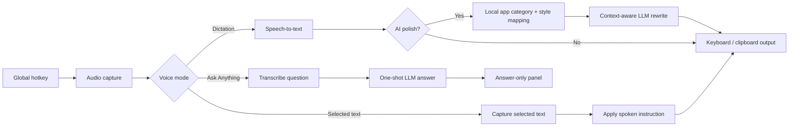
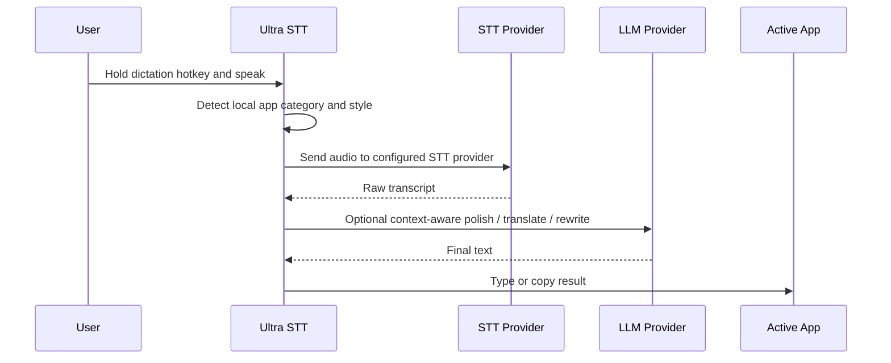
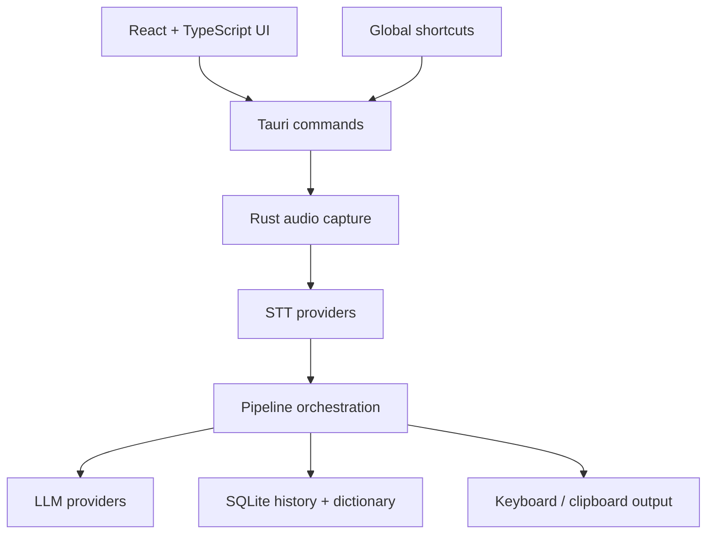

<p align="center">
  <strong>English</strong> | <a href="README_zh.md">中文</a> | <a href="README_ja.md">日本語</a> | <a href="README_ko.md">한국어</a> | <a href="README_es.md">Español</a> | <a href="README_fr.md">Français</a> | <a href="README_de.md">Deutsch</a> | <a href="README_pt.md">Português</a> | <a href="README_ru.md">Русский</a> | <a href="README_ar.md">العربية</a> | <a href="README_hi.md">हिन्दी</a> | <a href="README_it.md">Italiano</a> | <a href="README_tr.md">Türkçe</a> | <a href="README_vi.md">Tiếng Việt</a> | <a href="README_th.md">ภาษาไทย</a> | <a href="README_id.md">Bahasa Indonesia</a> | <a href="README_pl.md">Polski</a> | <a href="README_nl.md">Nederlands</a>
</p>

<p align="center">
  
</p>

<h1 align="center">Ultra STT</h1>

<p align="center">
  A personal voice keyboard for macOS and Windows, built on the OpenTypeless open-source project.
</p>

<p align="center">
  Speak naturally, transcribe locally or with your chosen provider, and type the result into the app you are using.<br/>
  Optional AI cleanup, translation, and voice Q&amp;A are available when configured.
</p>

<p align="center">
  <a href="https://github.com/toughCSB/ultra-stt/actions/workflows/ci.yml"></a>
  <a href="https://github.com/toughCSB/ultra-stt/releases"></a>
  <a href="LICENSE"></a>
</p>

<p align="center">
  <a href="https://github.com/toughCSB/ultra-stt/releases"><strong>Download</strong></a> ·
  <a href="#getting-started"><strong>Run locally</strong></a> ·
  <a href="https://github.com/toughCSB/ultra-stt/issues"><strong>Issues</strong></a>
</p>

<p align="center">
  Download the latest build or run Ultra STT from source.
</p>

<p align="center">
  
</p>

<p align="center">
  <strong>Voice typing</strong> · <strong>Local history</strong> · <strong>Optional AI cleanup</strong> · <strong>macOS and Windows</strong>
</p>

## At a Glance

- Global shortcuts start and stop voice capture without switching apps.
- Speech recognition can use supported providers or a local engine, depending on your setup.
- Results can be typed into the focused app or copied to the clipboard.
- Optional LLM cleanup, selected-text editing, and translation use the provider you configure.
- Transcription history and app preferences are stored locally.
- The system-tray icon opens and hides the main window.

> Provider availability depends on platform, configuration, and credentials. Ultra STT does not include a managed cloud quota or subscription service.

## Product Highlights

Ultra STT is focused on a fast, keyboard-first voice workflow:

- **App-aware writing** detects the active application locally and adapts structure and tone for email, chat, documents, issue trackers, coding tools, and more.
- **Voice intent routing** distinguishes dictation, selected-text editing, translation, Ask Anything, and supported voice actions in English, Simplified Chinese, and Traditional Chinese.
- **Multiple shortcuts per workflow** let you assign and reorder more than one binding for Dictation, Ask Anything, and Translation.
- **Switchable translation targets** make it faster to move between the languages you use instead of keeping one fixed output language.
- **A stronger local dictionary** adds correction rules plus dictionary import/export, so recurring names, terminology, and transcription mistakes stay under your control.
- **Per-app style mappings** let you override the built-in app category when a detected app needs a different writing style.

All application detection, mappings, dictionary entries, and correction rules are stored locally. App-aware polish sends only the internal app category and approved style metadata to the configured LLM path; raw window titles and document contents are not sent to the LLM or stored in history.

## Ask Anything

Ask Anything is an optional shortcut-first voice Q&A flow. Speak a question, stop recording, and the configured providers transcribe it and return a one-shot answer in a small floating note.

It is designed for quick answers with no chat history, no input box, and no extra send step. If selected-text context is enabled, Ask can also answer questions about the text currently selected in another app.

Default shortcuts now follow the Typeless-style flow:

| Platform | Dictation | Ask Anything | Translate selected text |
| -------- | --------- | ------------ | ----------------------- |
| macOS    | `Fn`      | `Fn+Space`   | `Fn+LeftShift`          |
| Windows  | `Right Alt` | `Right Alt+Space` | `Right Alt+LeftShift` |
| Linux    | `Ctrl+/`  | `Ctrl+.`     | configurable            |

Linux keeps conservative Ctrl-based defaults because global Right Alt handling is less reliable across desktop environments, especially on Wayland.

## Feature Examples

<p align="center">
  
</p>

<p align="center">
  
</p>

| App-aware AI polish                                                                                                  | Local dictionary and corrections                                                                                     |
| -------------------------------------------------------------------------------------------------------------------- | -------------------------------------------------------------------------------------------------------------------- |
|  |  |

<details>
<summary>Onboarding and voice workspace</summary>

| Onboarding                                                                             | Voice workspace                                                                                                 |
| -------------------------------------------------------------------------------------- | --------------------------------------------------------------------------------------------------------------- |
|  |  |

</details>

---

## What Ultra STT Does

Ultra STT provides voice-first desktop workflows:

| Workflow              | What happens                                                                                                           |
| --------------------- | ---------------------------------------------------------------------------------------------------------------------- |
| Dictation             | Hold a hotkey, speak, transcribe, optionally polish with an LLM, then type or copy the result into the active app      |
| Ask Anything          | Start a one-shot voice question, transcribe it, send it to the LLM, and show only the final answer in a small panel    |
| Selected-text editing | Select text in another app, speak an instruction, and let the LLM rewrite, summarize, translate, or fix that selection |
| Translation           | Use a dedicated shortcut, speak or select text, and send the result to one of your configured target languages         |

Use it for emails, chat replies, meeting notes, issue comments, prompts, documentation drafts, quick answers, multilingual translation, and any workflow where speaking is faster than typing.



## Why Ultra STT?

Ultra STT combines speech input, optional AI editing, and direct keyboard output in one desktop app.

|                        | Ultra STT                                                            | macOS Dictation | Windows Voice Typing | Whisper Desktop |
| ---------------------- | -------------------------------------------------------------------- | --------------- | -------------------- | --------------- |
| AI text polishing      | ✅ Multiple LLMs                                                     | ❌              | ❌                   | ❌              |
| Ask Anything voice Q&A | ✅                                                                   | ❌              | ❌                   | ❌              |
| STT provider choice    | ✅ Local and configurable providers                              | ❌ Apple only   | ❌ Microsoft only    | ❌ Whisper only |
| Works in any app       | ✅                                                                   | ✅              | ✅                   | ❌ Copy-paste   |
| Translation mode       | ✅                                                                   | ❌              | ❌                   | ❌              |
| Selected-text rewrite  | ✅                                                                   | ❌              | ❌                   | ❌              |
| App-aware writing      | ✅ Local detection and mappings                                      | ❌              | ❌                   | ❌              |
| Multiple shortcuts     | ✅ Per voice workflow                                                 | ❌              | ❌                   | ❌              |
| Open source            | ✅ MIT-based codebase                                                | ❌              | ❌                   | ✅              |
| Cross-platform         | ✅ macOS / Windows                                                    | ❌ Mac only     | ❌ Windows only      | ✅              |
| Custom dictionary      | ✅                                                                   | ❌              | ❌                   | ❌              |
| Self-hostable          | ✅ BYOK                                                              | ❌              | ❌                   | ✅              |

## Features

| Area              | Highlights                                                                                                                                  |
| ----------------- | ------------------------------------------------------------------------------------------------------------------------------------------- |
| Voice capture     | Native Fn / Right Alt hotkeys on macOS/Windows, Linux Ctrl defaults, multiple bindings per workflow, hold or toggle mode, floating capsule states, idle auto-hide |
| AI rewriting      | App-aware writing, local per-app style mappings, polish styles, streaming polish, selected-text context, and custom instructions             |
| Ask Anything      | One-shot voice question flow: record in the capsule, think, then show a small answer note with copy support                                 |
| Voice actions     | Deterministic English, Simplified Chinese, and Traditional Chinese routing for editing, translation, Ask, and supported actions              |
| STT providers     | Local speech recognition and configurable remote providers, depending on platform and setup                                                |
| LLM providers     | Configurable LLM providers, including OpenAI-compatible services and local endpoints                                                      |
| Output            | Keyboard simulation, clipboard paste/copy-only, Windows SendInput, clipboard restore, and output-failure diagnostics                       |
| Language          | Auto-detect speech, dedicated translation shortcut, switchable target languages, and 20+ translation targets                                |
| Dictionary        | Custom terms, import/export, and local correction rules for recurring transcription mistakes                                                 |
| Scenes            | Built-in scenes, local custom scenes, active scene metadata, import/export for reusable writing styles                                      |
| Privacy           | Local app detection and mappings, provider keys in the OS credential vault where available, plus BYOK and local/self-hosted paths            |
| History           | Searchable local transcription history and recording statistics                                                                            |
| Desktop polish    | Dark/light/system theme, onboarding, auto-start, tray controls, macOS and Windows Tauri app                                                  |

UI localization currently ships with complete English and Chinese copy, plus additional locale files that may still fall back to English for newer advanced features.

## How The App Thinks



> [!TIP]
> **Recommended Configuration for Best Experience**
>
> |              | Provider | Model                    |
> | ------------ | -------- | ------------------------ |
> | 🗣️ STT       | Groq     | `whisper-large-v3-turbo` |
> | 🤖 AI Polish | Google   | `gemini-2.5-flash`       |
>
> Provider pricing, availability, and model behavior are controlled by the providers; choose settings that fit your needs.

## Try It in 5 Minutes

1. Download the latest build for your platform from [Releases](https://github.com/toughCSB/ultra-stt/releases).
2. Configure a speech provider in **Settings**. Add provider credentials if required.
3. Pick speech recognition and AI polish providers in Settings.
4. Set one or more shortcuts for Dictation, Ask Anything, and Translation.
5. Focus a text field, use the shortcut, speak, and review the result in the target app.

## Download

Download the latest version for your platform:

**[Download the latest release](https://github.com/toughCSB/ultra-stt/releases/latest)**

| Platform | File                                         |
| -------- | -------------------------------------------- |
| Windows  | `.msi` installer or `.exe` setup             |
| macOS    | Universal `.dmg` for Apple Silicon and Intel |
| Linux    | `.AppImage` / `.deb` / `.rpm`                |

## Installation Notes

Release signing differs by platform while distribution is being improved. Always download from the official [GitHub Releases](https://github.com/toughCSB/ultra-stt/releases) page.

### Windows

Windows SmartScreen may show "Windows protected your PC":

1. Click **More info**
2. Click **Run anyway**

If the installer shows a publisher validation warning:

1. Right-click the `.msi` file → **Properties**
2. Check **Unblock** at the bottom → **Apply**
3. Run the installer again

### macOS

macOS may ask you to grant microphone and Accessibility permissions. Allow them in **System Settings → Privacy & Security** so recording and keyboard output can work.

### Linux

**Ubuntu/Debian** — install the `.deb` package:

```bash
sudo apt install ./OpenTypeless_x.x.x_amd64.deb
```

**AppImage** — make it executable and run:

```bash
chmod +x OpenTypeless_x.x.x_amd64.AppImage
./OpenTypeless_x.x.x_amd64.AppImage
```

**NVIDIA + Wayland users:** The app auto-detects this configuration and applies a workaround. If it still crashes on startup, run:

```bash
WEBKIT_DISABLE_DMABUF_RENDERER=1 ./OpenTypeless
```

**Wayland users:** the required helper depends on the compositor:

- KDE Plasma/KWin Wayland uses [`kwtype`](https://github.com/Sporif/KWtype), which must currently be built and installed using the upstream instructions.
- Other Wayland compositors use `wtype`. On Ubuntu/Debian run `sudo apt install wtype`; on Arch/Manjaro run `sudo pacman -S wtype`.

Global hotkeys can still depend on the desktop environment. If the matching helper is unavailable or fails, Ultra STT keeps the result in the clipboard instead of running an untrusted user script.

## Prerequisites

- [Node.js](https://nodejs.org/) 20+
- [Rust](https://rustup.rs/) (stable toolchain)
- Platform-specific dependencies for Tauri: see [Tauri Prerequisites](https://v2.tauri.app/start/prerequisites/)

## Getting Started

```bash
# Install dependencies
npm install

# Run in development mode
npm run tauri dev

# Build for production
npm run tauri build
```

The built application will be in `src-tauri/target/release/bundle/`.

## Configuration

All settings are accessible from the in-app Settings panel:

- **Speech Recognition** — choose STT provider and enter your API key
- **AI Polish** — choose an LLM provider and model, enable app-aware writing, manage per-app style mappings, and configure selected-text context
- **General** — manage multiple Dictation, Ask Anything, and Translation shortcuts, output mode, auto-start, and idle capsule visibility
- **Dictionary** — add or import custom terms, export your dictionary, and create local correction rules for recurring transcription mistakes
- **Scenes** — built-in and local prompt templates with import/export for reusable writing styles

Provider credentials are stored locally using the platform's available secure storage. Audio and text are sent to the provider selected in settings when you use that provider. Review its privacy and retention policies before use.

Ultra STT does not require an Ultra STT account. A network connection is needed for remote providers and update/download checks; local engines can be used where supported and configured. No managed cloud quota or subscription service is included.

## Architecture

**Desktop pipeline:**



```
src/                  # React frontend (TypeScript)
├── components/       # UI components (Settings, History, Capsule, etc.)
├── hooks/            # React hooks (recording, theme, Tauri events)
├── lib/              # Utilities (API client, router, constants)
└── stores/           # Zustand state management

src-tauri/src/        # Rust backend
├── audio/            # Audio capture via cpal
├── stt/              # Speech recognition providers and local engines
├── llm/              # LLM providers and local-compatible endpoints
├── output/           # Text output (keyboard simulation, clipboard paste)
├── storage/          # Config (tauri-plugin-store) + history/dictionary (SQLite)
├── app_detector/     # Detect active application for context
├── pipeline.rs       # Recording → STT → LLM → Output orchestration
└── lib.rs            # Tauri app setup, commands, hotkey handling
```

## Roadmap

- [ ] Usage summary UI for aggregate audio time and word counts
- [ ] More provider-specific setup diagnostics
- [ ] Better Linux desktop-environment guidance
- [ ] More workflow presets for writing, coding, and support replies
- [ ] Plugin-style provider extensions

## FAQ

**Where does my audio go?**
Local engines process audio on your device. If you select a remote STT provider, audio is sent to that provider; optional AI features send the relevant text to your configured LLM. Check each provider's privacy policy.

**Can I use it offline?**
Offline use depends on having a supported local STT engine and, for AI cleanup, a local LLM endpoint configured. Remote services require an internet connection.

**Which languages are supported?**
STT supports 99+ languages depending on the provider. AI polish and translation support 20+ target languages.

**Does Ultra STT have a subscription?**
No managed quota or subscription is included. Remote provider fees, if any, are billed by those providers.

## Community

- 🐛 [Issue Tracker](https://github.com/toughCSB/ultra-stt/issues) — Bug reports, questions, and feature requests
- 📖 [Contributing Guide](CONTRIBUTING.md) — Development setup and guidelines
- 🔒 [Security Policy](SECURITY.md) — Report vulnerabilities responsibly
- 🧭 [Vision](VISION.md) — Project principles and roadmap direction

## Contributing

Contributions are welcome! See [CONTRIBUTING.md](CONTRIBUTING.md) for development setup and guidelines.

Looking for a place to start? Browse the [open issues](https://github.com/toughCSB/ultra-stt/issues).

## Built With

- [Tauri](https://tauri.app/) for the desktop shell
- [React](https://react.dev/) and [TypeScript](https://www.typescriptlang.org/) for the UI
- [Rust](https://www.rust-lang.org/) for audio capture, providers, hotkeys, output, and local storage
- [i18next](https://www.i18next.com/) for multilingual UI

## License

[MIT](LICENSE)
