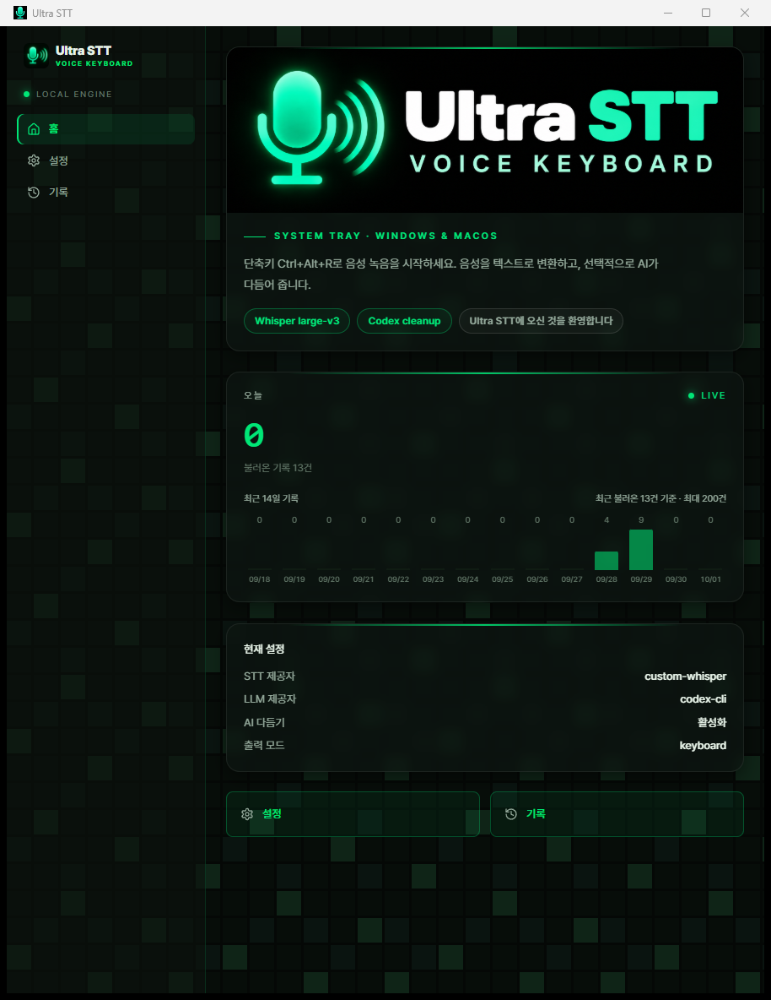

<p align="center">
  <a href="README.md">English</a> | <a href="README_zh.md">中文</a> | <a href="README_ja.md">日本語</a> | <strong>한국어</strong> | <a href="README_es.md">Español</a> | <a href="README_fr.md">Français</a> | <a href="README_de.md">Deutsch</a> | <a href="README_pt.md">Português</a> | <a href="README_ru.md">Русский</a> | <a href="README_ar.md">العربية</a> | <a href="README_hi.md">हिन्दी</a> | <a href="README_it.md">Italiano</a> | <a href="README_tr.md">Türkçe</a> | <a href="README_vi.md">Tiếng Việt</a> | <a href="README_th.md">ภาษาไทย</a> | <a href="README_id.md">Bahasa Indonesia</a> | <a href="README_pl.md">Polski</a> | <a href="README_nl.md">Nederlands</a>
</p>

<p align="center">
  
</p>

<h1 align="center">Ultra STT</h1>

<p align="center">
  OpenTypeless 오픈소스 프로젝트를 바탕으로 만든 macOS·Windows용 음성 키보드입니다.
</p>

<p align="center">
  단축키를 누르고 말하면 음성을 전사해 현재 사용 중인 앱에 입력합니다.<br/>
  설정에 따라 로컬 또는 선택한 제공자로 전사하며, AI 다듬기·번역·음성 질문은 선택 기능입니다.
</p>

<p align="center">
  <a href="https://github.com/toughCSB/ultra-stt/actions/workflows/ci.yml"></a>
  <a href="https://github.com/toughCSB/ultra-stt/releases"></a>
  <a href="LICENSE"></a>
</p>

<p align="center">
  
</p>

## 한눈에 보기

- 전역 단축키로 앱을 전환하지 않고 음성 입력을 시작·종료합니다.
- 플랫폼과 설정에 따라 로컬 엔진 또는 선택한 음성 인식 제공자를 사용합니다.
- 결과를 현재 커서 위치에 입력하거나 클립보드에 복사합니다.
- 설정한 LLM을 통한 문장 다듬기·선택 텍스트 편집·번역·음성 질문을 지원합니다.
- 전사 기록과 앱 설정은 로컬에 저장합니다.
- 시스템 트레이 아이콘을 클릭해 메인 창을 열거나 숨깁니다.

> 제공자와 기능은 운영체제, 설정, 인증 정보에 따라 달라집니다. 관리형 클라우드 할당량이나 구독 서비스는 포함하지 않습니다.

## 주요 기능

- **앱 인식 글쓰기**는 현재 앱을 로컬에서 감지하고 이메일, 채팅, 문서, 이슈 트래커, 개발 도구 등에 맞게 구조와 어조를 조정합니다.
- **음성 의도 라우팅**은 일반 받아쓰기, 선택 텍스트 편집, 번역, Ask Anything, 지원되는 음성 작업을 영어, 중국어 간체 및 번체에서 구분합니다.
- **워크플로별 여러 단축키**를 사용해 받아쓰기, Ask Anything, 번역에 둘 이상의 키 조합을 추가하고 순서를 바꿀 수 있습니다.
- **전환 가능한 번역 대상**으로 출력 언어를 하나로 고정하지 않고 자주 쓰는 언어 사이를 빠르게 바꿀 수 있습니다.
- **강화된 로컬 사전**은 수정 규칙과 사전 가져오기/내보내기를 지원합니다.
- **앱별 스타일 매핑**으로 기본 앱 분류를 재정의하고 특정 앱에 다른 글쓰기 스타일을 지정할 수 있습니다.

앱 감지, 매핑, 사전 항목 및 수정 규칙은 모두 로컬에 저장됩니다. 앱 인식 다듬기는 내부 앱 분류와 승인된 스타일 메타데이터만 설정한 LLM 경로로 전송합니다. 원본 창 제목과 문서 내용은 앱 컨텍스트로 전송되거나 기록에 저장되지 않습니다.

| 앱 인식 AI 다듬기 | 로컬 사전 및 수정 규칙 |
| --- | --- |
|  |  |

<details>
<summary>더 많은 스크린샷</summary>

<p align="center">
  
</p>

| 설정 | 기록 |
|---|---|
|  |  |

</details>

---

## 주요 기능

| | Ultra STT | macOS Dictation | Windows Voice Typing | Whisper Desktop |
|---|---|---|---|---|
| AI 텍스트 다듬기 | ✅ 다중 LLM | ❌ | ❌ | ❌ |
| STT 제공자 선택 | ✅ 로컬·설정 가능한 제공자 | ❌ Apple만 | ❌ Microsoft만 | ❌ Whisper만 |
| 모든 앱에서 작동 | ✅ | ✅ | ✅ | ❌ 복사-붙여넣기 |
| 번역 모드 | ✅ | ❌ | ❌ | ❌ |
| 오픈 소스 | ✅ MIT | ❌ | ❌ | ✅ |
| 플랫폼 | ✅ macOS / Windows | ❌ Mac만 | ❌ Windows만 | ✅ |
| 사용자 사전 | ✅ | ❌ | ❌ | ❌ |
| 셀프 호스팅 가능 | ✅ BYOK | ❌ | ❌ | ✅ |

## 기능

- 🎙️ 글로벌 단축키 녹음 — 길게 눌러 녹음 또는 토글 모드
- 💊 항상 위에 표시되는 플로팅 캡슐 위젯
- 🗣️ 플랫폼과 구성에 맞춘 로컬·원격 STT 제공자
- 🤖 설정한 원격 또는 로컬 LLM으로 텍스트 다듬기
- ⚡ 스트리밍 출력 — LLM이 생성하는 대로 텍스트 표시
- ⌨️ 키보드 시뮬레이션 또는 클립보드 출력
- 📝 녹음 전 텍스트를 선택하면 LLM에 컨텍스트로 전달
- 🌐 번역 모드: 한 언어로 말하고 다른 언어로 출력 (20+ 언어)
- 📖 전문 용어를 위한 사용자 사전
- 🔍 앱별 감지로 포맷 자동 조정
- 📜 전체 텍스트 검색이 가능한 로컬 기록
- 🌗 다크 / 라이트 / 시스템 테마
- 🚀 로그인 시 자동 시작

> [!TIP]
> **최고의 경험을 위한 추천 설정**
>
> | | 제공자 | 모델 |
> |---|---|---|
> | 🗣️ STT | Groq | `whisper-large-v3-turbo` |
> | 🤖 AI 다듬기 | Google | `gemini-2.5-flash` |
>
> 제공자의 요금·가용성·모델 동작은 각 제공자가 관리합니다. 사용 전 해당 서비스의 조건을 확인하세요.

## 다운로드

플랫폼에 맞는 최신 버전을 다운로드하세요:

**[Releases에서 다운로드](https://github.com/toughCSB/ultra-stt/releases)**

| 플랫폼 | 파일 |
|--------|------|
| Windows | `.msi` 설치 프로그램 |
| macOS (Apple Silicon) | `.dmg` |
| macOS (Intel) | `.dmg` |
| Linux | `.AppImage` / `.deb` |

## 사전 요구사항

- [Node.js](https://nodejs.org/) 20+
- [Rust](https://rustup.rs/) (stable 툴체인)
- Tauri 플랫폼별 의존성: [Tauri 사전 요구사항](https://v2.tauri.app/start/prerequisites/) 참조

## 시작하기

```bash
# 의존성 설치
npm install

# 개발 모드 실행
npm run tauri dev

# 프로덕션 빌드
npm run tauri build
```

빌드된 애플리케이션은 `src-tauri/target/release/bundle/`에 위치합니다.

## 설정

모든 설정은 앱 내 설정 패널에서 접근할 수 있습니다:

- **음성 인식** — STT 제공자를 선택하고 API 키를 입력
- **AI 다듬기** — LLM 제공자, 모델, API 키를 선택
- **일반** — 단축키, 출력 모드, 테마, 자동 시작
- **사전** — 더 나은 전사 정확도를 위한 사용자 용어 추가
- **장면** — 다양한 사용 사례를 위한 프롬프트 템플릿

제공자 인증 정보는 플랫폼에서 사용할 수 있는 보안 저장소를 이용해 로컬에 보관합니다. 원격 STT를 선택하면 음성이 해당 제공자로 전송되고, 선택형 AI 기능을 사용하면 관련 텍스트가 설정한 LLM으로 전송됩니다. 사용 전에 각 제공자의 개인정보 처리 방침을 확인하세요.

Ultra STT 계정은 필요하지 않습니다. 원격 제공자 이용에는 인터넷 연결이 필요하며, 로컬 엔진은 지원되는 환경에서 설정해 사용할 수 있습니다. 관리형 할당량이나 구독은 제공하지 않습니다.

## 아키텍처

**데이터 흐름 파이프라인:**

```
마이크 → 오디오 캡처 → STT 제공자 → 원시 전사 → LLM 다듬기 → 키보드/클립보드 출력
```

```
src/                  # React 프론트엔드 (TypeScript)
├── components/       # UI 컴포넌트 (설정, 기록, 캡슐 등)
├── hooks/            # React 훅 (녹음, 테마, Tauri 이벤트)
├── lib/              # 유틸리티 (API 클라이언트, 라우터, 상수)
└── stores/           # Zustand 상태 관리

src-tauri/src/        # Rust 백엔드
├── audio/            # cpal을 통한 오디오 캡처
├── stt/              # STT 제공자 및 로컬 엔진
├── llm/              # LLM 제공자 및 로컬 호환 엔드포인트
├── output/           # 텍스트 출력 (키보드 시뮬레이션, 클립보드 붙여넣기)
├── storage/          # 설정 (tauri-plugin-store) + 기록/사전 (SQLite)
├── app_detector/     # 컨텍스트를 위한 활성 애플리케이션 감지
├── pipeline.rs       # 녹음 → STT → LLM → 출력 오케스트레이션
└── lib.rs            # Tauri 앱 설정, 명령, 단축키 처리
```

## 로드맵

- [ ] 커스텀 STT/LLM 통합을 위한 플러그인 시스템
- [ ] 다국어 STT 정확도 및 방언 지원 개선
- [ ] 음성 명령
- [ ] 사용자 정의 단축키 조합
- [ ] 온보딩 경험 개선
- [ ] 모바일 컴패니언 앱

## 자주 묻는 질문

**음성 데이터는 어디로 전송되나요?**
로컬 엔진은 기기에서 처리합니다. 원격 STT를 선택하면 음성이 해당 제공자로 전송되고, 선택형 AI 기능은 관련 텍스트를 설정한 LLM으로 보냅니다. 각 제공자의 개인정보 처리 방침을 확인하세요.

**오프라인에서 사용할 수 있나요?**
오프라인 사용 여부는 지원되는 로컬 STT 엔진과 로컬 LLM을 구성했는지에 따라 달라집니다. 원격 제공자는 인터넷 연결이 필요합니다.

**어떤 언어가 지원되나요?**
STT는 제공자에 따라 99개 이상의 언어를 지원합니다. AI 다듬기와 번역은 20개 이상의 대상 언어를 지원합니다.

**구독이나 사용량 요금제가 있나요?**
관리형 할당량이나 구독은 포함하지 않습니다. 원격 제공자의 사용료가 발생할 수 있으며, 해당 제공자가 직접 청구합니다.

## 커뮤니티

- 🐛 [Issue Tracker](https://github.com/toughCSB/ultra-stt/issues) — 버그 보고, 질문, 기능 요청
- 📖 [기여 가이드](CONTRIBUTING.md) — 개발 설정 및 가이드라인
- 🔒 [보안 정책](SECURITY.md) — 취약점을 책임감 있게 보고
- 🧭 [비전](VISION.md) — 프로젝트 원칙 및 로드맵 방향

## 기여하기

기여를 환영합니다! 개발 설정 및 가이드라인은 [CONTRIBUTING.md](CONTRIBUTING.md)를 참조하세요.

시작할 곳을 찾고 계신가요? [열린 이슈](https://github.com/toughCSB/ultra-stt/issues)를 확인하세요.

## 라이선스

[MIT](LICENSE)
