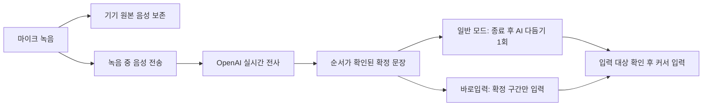

# Ultra STT 전사 엔진·완료 속도 재설계

검토일: 2026-10-29. 상태: **조사·설계 완료. 유료 API 미호출, 교체 미적용.**

외부 실사용·벤치마크 추가 조사: [의사결정 보고서](2026-10-29-stt-external-evidence.md). 후속 근거에 따라 권고를 좁혔다. 일반 파일 전사는 우선 비교하되 **한국어 실시간 전사의 기본 채택은 보류**한다. 새 모델의 장문 누락 경험과 조건에 따라 크게 다른 한국어 자료가 있어, 품질과 구간 보존 검증을 먼저 통과해야 한다.

## 1. 제안 결론

일반 전사는 **`gpt-transcribe`**, 녹음 중 전사와 바로입력은 **`gpt-live-transcribe`**를 우선 평가한다. 두 경로를 실제 한국어 음성으로 비교해 품질과 지연을 통과한 경로만 기본값으로 채택한다. 최신 공식 전사 안내도 완료된 파일과 실시간 음성을 이 두 모델로 구분한다. [`Transcription`](https://developers.openai.com/api/docs/guides/transcription)

최적화 순서는 **구간별 시간 계측 → 유료 전사 비교 → 녹음 중 처리 → AI 다듬기 호출 경로 비교 → 필요한 로컬 메모리 최적화**다. SB 전체 과부하 복구는 별도 작업으로 두며 이번 설계에서 시스템 설정을 변경하지 않는다.

API는 로컬 GPU 모델 로딩과 추론에 대한 의존성을 없앤다. 그러나 정상 상태의 로컬 엔진보다 항상 빠르다는 뜻은 아니다. 네트워크·업로드·서버 처리·AI 다듬기·커서 입력까지 포함한 실측이 필요하다. 키를 사용하기 전에는 우리 앱에서 몇 초가 걸릴지, 한국어 품질이 얼마나 달라질지 확정할 수 없다.

## 2. 현재 확인된 것과 아직 모르는 것

현재 로컬 엔진은 `Systran/faster-whisper-large-v3`, CTranslate2 `float16`이다. API의 `whisper-1`은 이 설치본과 같은 모델 ID가 아니다. 공식 API 참조는 `whisper-1`을 Whisper V2 기반으로 설명한다. [`Create transcription`](https://developers.openai.com/api/reference/resources/audio/subresources/transcriptions/methods/create)

이번 장애 조사에서 3.255초 합성 음성의 로컬 전사가 수초~수십 초로 흔들렸고, 모델 준비 120초 제한과 전사 실패도 있었다. Mac 요청 한 건은 STT 약 13.6초와 AI 다듬기 약 4.0초로 나뉘었다. 이 수치는 **장애 당시 측정**이며 정상 로컬 성능의 기준으로 쓰지 않는다. 근거는 상위 `qa/incident-20261029/`의 서비스 JSON과 앱 로그다.

저메모리 대조 시험은 로딩 6.6초, 같은 짧은 음성의 전사 0.45~0.80초였다. 하지만 합성 표본과 제한된 공개 한국어 자료만으로 모든 음성의 품질을 보장할 수 없다. FP16과 API를 비교할 때는 시스템 부하도 함께 기록해 장애 상태와 정상 상태를 분리한다.

현재까지 OpenAI 유료 엔진의 실제 속도·한국어 정확도·계정 접근 권한·실제 청구액은 **미검증**이다. 이번 작업에서 사용자 음성을 OpenAI 전사 API에 보내거나 API 키를 읽지 않는다.

## 3. 현재 OpenAI 후보와 제외 이유

| 후보 | 역할 | 신규 도입 판단 |
|---|---|---|
| `gpt-transcribe` | 완료된 녹음, 파일 전사, 확정된 Realtime turn 전사 | 정확도·비용 기준 경로로 우선 평가 |
| `gpt-live-transcribe` | 음성을 보내는 동안 부분 전사 생성 | 체감 속도와 바로입력의 우선 후보 |
| `gpt-realtime-whisper` | 기존 실시간 연동 지원 | 공식 안내가 신규 시작 모델로 권장하지 않아 기본 후보에서 제외 |
| `gpt-4o-transcribe`, `gpt-4o-mini-transcribe`, `whisper-1` | 기존 전사 API | 신규 주력으로 채택하지 않음 |

`gpt-transcribe`는 문맥·키워드·복수 언어 힌트를 지원하는 고정확도 전사 모델로 소개된다. `gpt-live-transcribe`는 지연 조절과 실시간 전사에 초점을 둔다. 이 설명을 한국어 실측 순위나 무오류 보증으로 해석하지 않는다. [GPT-Transcribe](https://developers.openai.com/api/docs/models/gpt-transcribe), [GPT-Live-Transcribe](https://developers.openai.com/api/docs/models/gpt-live-transcribe)

구형 Whisper/GPT-4o 전사 계열은 2026-08-26에 지원 종료가 공지됐고 종료 예정일은 **2027-02-26**이다. 기존 로컬 large-v3 파일의 사용 종료를 뜻하는 공지는 아니다. [공식 지원 종료 공지](https://developers.openai.com/api/docs/deprecations#2026-08-26-transcription-models)

## 4. 예상 비용

아래는 공식 분당 요금으로 계산한 **전사만의 비용**이다. 세금·환율·AI 다듬기·재시도·추가 재전사는 별도다. 실제 입력 음성 시간과 API 사용량으로 정산한다. [공식 가격표](https://developers.openai.com/api/docs/pricing)

| 모델 | 1분 | 1시간 | 하루 1시간 × 30일 |
|---|---:|---:|---:|
| `gpt-transcribe` | $0.0045 | $0.27 | $8.10 |
| `gpt-live-transcribe` | $0.017 | $1.02 | $30.60 |

실시간 경로는 같은 음성 시간 기준 약 3.78배다. 일반 전사를 모두 실시간으로 바꾸기 전에 실제 종료 후 대기 감소가 비용 차이에 맞는지 평가한다. 한 음성을 매번 실시간과 파일 모델 양쪽에 보내면 이중 과금되므로 기본 설계로 삼지 않는다.

가격과 접근 가능 모델은 API 프로젝트에서 확인한다. 기존 ChatGPT/Codex 구독의 사용량 조건과 API 프로젝트의 과금을 동일하게 취급하지 않는다.

## 5. 속도는 어떤 구간을 바꿀 것인가

측정할 사용자 체감 시간은 **녹음 종료 → 커서 입력 완료**다. 별도로 녹음 시작 반응과 최초 전사 표시 시간을 기록한다.

현재 일반 전사의 직렬 경로:

`녹음 종료 → 기기/SB 전송 → 전사 대기·실행 → AI 다듬기 → 대상 확인 → 커서 입력`

파일 API 교체는 전사 부분을 교체한다. 실시간 구조는 녹음 중 전송과 전사를 진행해 종료 후 남은 작업을 줄이는 설계다. 완료된 파일에 `stream=true`를 주는 것은 결과 표시 방식이며, 녹음 중 음성을 보내는 Realtime과 구분해야 한다. [전사 워크플로 비교](https://developers.openai.com/api/docs/guides/transcription)

이 도식은 제안 구조이며 현재 앱이 이미 이렇게 구현됐다는 뜻이 아니다. 부분 전사 표시가 빨라져도 최종 커서 입력이 빨라지지 않으면 완료 속도 개선으로 집계하지 않는다.

## 6. 단계별 적용 설계

### A. 비교 기준과 원문 보존부터

- 시간 기록: 녹음 준비, 마지막 오디오 수집, 전송 완료, 전사 최초/최종, AI 최초/최종, 커서 입력 완료.
- 각 결과에 세션 ID, 실제 엔진·모델, 음성 길이, 요청 ID, 재시도·오류 유형을 남긴다. API 키와 원문 내용을 진단 로그에 기본 출력하지 않는다.
- 전사 원문을 AI 입력 전 별도 보존한다. AI 다듬기 실패가 전사문까지 삭제하지 않게 한다.
- 기존 입력 대상 보호와 명시 취소 후 늦은 결과 폐기를 모든 경로에서 유지한다.
- 현재의 다섯 다듬기 스타일은 유지한다. **‘원문’ 스타일을 AI 미사용과 동일시하지 않는다.** 원문 스타일도 오타·오인식·군더더기 정리라는 기존 약속을 따른다. 바로입력의 AI 미사용 동작도 유지한다.

### B. 파일 전사로 품질·비용 기준 확보

- 첫 후보는 `gpt-transcribe`의 JSON 응답이다. `/v1/audio/transcriptions`에 명시적 파일명과 올바른 WAV MIME을 보낸다.
- 신규 모델은 복수형 `languages`를 사용한다. 기존 어댑터의 `language`를 그대로 보내거나 두 필드를 함께 보내지 않는다. 한국어·영어 혼용과 전문 용어는 작은 관련 힌트 목록으로 시험한다. [파일 전사 안내](https://developers.openai.com/api/docs/guides/speech-to-text)
- 신규 모델에 구형 전용 logprobs/타임스탬프 지원을 가정하지 않는다. 출력 본문, 완료 이벤트, 요청별 사용량과 오류를 명시적으로 검사한다. [전사 API 계약](https://developers.openai.com/api/reference/resources/audio/subresources/transcriptions/methods/create)
- 기존 인증된 SB 연결을 유지하는 1차 경로를 평가한다. SB는 클라우드 요청을 중계하고 로컬 GPU 추론은 실행하지 않는 역할이다. 다만 SB 경유·가용성 의존은 남으므로 장기적으로 기기 직접 연결의 이득도 별도 측정한다.
- 클라이언트 STT 선택과 서버의 upstream 선택을 구분한다. 서버가 자기 remote endpoint를 재호출하는 재귀 구성을 허용하지 않는다.
- 데스크톱의 녹음 복구 재전사는 현재 `custom-whisper`만 허용한다. 새 전용 OpenAI 공급자를 추가할 때 이 복구 경로도 연결해야 한다. 실패 원음만 남고 새 엔진으로 재시도할 수 없는 상태를 완료로 보지 않는다.
- 원격 응답의 `raw`, `text`, 다듬기 완료 여부를 명확히 구분한다. 기존 클라이언트의 `text` 호환성을 유지하면서, 일반 받아쓰기에서 서버와 클라이언트가 같은 문장을 두 번 다듬거나 양쪽 모두 생략하는 경우를 차단한다. 기존 preset 이름만 보고 판단하는 계약을 검토한다.

### C. 녹음 중 전사로 종료 후 대기 감소

- 다음 후보는 `gpt-live-transcribe`다. 현재 공식 안내의 transcription WebSocket 세션과 24kHz PCM 형식에 맞춘 전용 어댑터가 필요하다.
- 일반 모드에서는 부분 결과를 미리 수신하되 외부 편집창에 넣지 않는다. 종료 후 모든 확정 구간을 합치고 기존 스타일로 AI 다듬기를 한 번 수행한다.
- 바로입력은 확정된 구간만 순서대로 입력한다. 수정될 수 있는 partial을 먼저 타이핑했다가 사용자의 문장을 임의로 지우는 설계를 기본으로 삼지 않는다.
- `gpt-live-transcribe` 안내는 server/semantic VAD를 지원하지 않는다고 명시한다. 앱의 종료 버튼 또는 클라이언트 발화 구간 감지로 commit을 관리한다. 완료 이벤트는 도착 순서대로 합치지 않고 `item_id`와 로컬 순서에 연결한다. [Realtime 전사 안내](https://developers.openai.com/api/docs/guides/realtime-transcription)
- 지연은 `medium`부터 품질을 비교하고 `low`를 추가 시험하는 방향을 제안한다. 낮은 delay가 정확도와 상충할 수 있으며 고정 ms 보장은 없다. 가이드와 일부 API 참조의 delay 지원 모델 설명이 서로 달라, 실제 계정의 session.update 수락을 먼저 검증한다. [가이드](https://developers.openai.com/api/docs/guides/realtime-transcription#tune-latency-and-accuracy), [세션 생성 참조](https://developers.openai.com/api/reference/resources/realtime/subresources/transcription_sessions/methods/create)
- 연결 준비 전에 들어온 첫 음성을 보존하고, 느린 네트워크에서는 제한된 메모리 큐와 원본 파일로 이어 간다. 재접속 후 같은 확정 구간을 중복 입력하지 않는다.
- 휴대폰은 현재 전송 방식 확인 후 스트리밍 전송을 추가하는 별도 클라이언트 작업으로 계획한다. 서버 교체만으로 녹음 중 스트리밍까지 생겼다고 표시하지 않는다.

### D. AI 다듬기 대기 별도 개선

전사 엔진을 바꿔도 기존 약 4초의 AI 구간은 별도다. 우선 같은 `gpt-6-luna`, 같은 다섯 스타일의 프롬프트로 **Codex CLI 대 직접 Responses API**를 비교한다. CLI 실행·인증 준비가 사라지는 이득과 실제 모델 응답 시간을 구분한다. 같은 모델명이라도 두 서비스 경로의 속도·동작이 같다고 가정하지 않는다.

직접 API 비교에서는 일반 받아쓰기의 `none`/`low`, 복잡한 편집의 기존 `medium`을 시험한다. Luna 공식 모델 문서는 이 추론 수준을 지원한다. 첫 비교는 기존 Low/Medium과 같은 조건으로 진행하고, 추론 수준 변경은 별도 축으로 분리한다. [GPT-6 Luna](https://developers.openai.com/api/docs/models/gpt-6-luna)

Fast도 Standard와 별도 측정하고 실제 응답의 `service_tier`를 기록한다. Fast는 지원되는 Responses/Chat Completions의 기능이므로 전사 API에도 동일한 옵션이 있다고 가정하지 않는다. [Fast mode](https://developers.openai.com/api/docs/guides/fast-mode)

출력은 정리된 본문만 요청하고 도구 호출·작업 계획·설명 문장을 만들지 않는다. 입력 연결을 재사용하고 독립적인 준비 작업을 녹음 중 처리한다. 원문과 필요한 문장 자체를 잘라서 속도 목표를 맞추지 않는다. 이러한 방향은 요청 수·출력 비용·순차 대기를 줄이는 공식 지연 최적화 원칙을 적용한 **우리 앱의 제안**이다. [Latency optimization](https://developers.openai.com/api/docs/guides/latency-optimization)

### E. 기기별 구조

| 단계 | SV/SB | Home·Mac | Fold7 |
|---|---|---|---|
| 파일 API 시험 | 안전한 키 저장·전사 upstream 선택 | 기존 연결로 품질/속도 확인 | 기존 파일 전송으로 품질/속도 확인 |
| 실시간 전사 | OpenAI WS 어댑터·세션 관리 | 녹음 중 전송·확정 결과 처리 | 녹음 중 업로드를 위한 앱 변경 필요 |
| 직접 연결 검토 | 공유 서버의 선택적 역할 유지 | 기기 보안 저장소 또는 단기 세션 인증 | APK에 장기 키 내장 없이 인증 구조 검토 |

초기에는 한 곳의 API 키와 기존 기기 인증을 유지하는 중계 방식이 변경 범위가 작다. 직접 연결은 SB를 거치지 않는 이점이 있으나 키 관리·다듬기 경로·모바일 구현 비용이 있으므로 단계 B의 필수 조건으로 늘리지 않는다.

## 7. 5~10분 녹음은 별도 완료 조건

**현재 코드에서 발견한 격차:** Android의 `WavCodec.MAX_SECONDS`는 120초이고 HTTP 전체 기한은 150초다. 모바일 입력 복구는 문자 결과를 메모리에 보관하며 원음의 지속 보존은 확인되지 않았다. 따라서 휴대폰의 5~10분 지원은 서버 모델명 교체와 별도의 작업이다. 녹음 길이·업로드·원음 보존·앱 재시작 복구를 함께 변경하고 검증해야 한다.

10분 mono PCM16/16kHz는 `600 × 16000 × 2 = 19,200,000 bytes`에 WAV 헤더가 더해진다. 문서의 파일 업로드 25MB 범위 안에 있지만 앱의 제한도 모두 일치해야 한다. 24kHz로 10분 WAV를 만들면 약 28.8MB이므로 Realtime용 오디오를 그대로 파일 재전송하지 않는다. 이 수치는 PCM 규격에서 계산한 값이다. [파일 크기 제한](https://developers.openai.com/api/docs/guides/speech-to-text)

- 녹음 제한, 클라이언트 payload 제한, SB 요청 제한, 외부 API 제한을 함께 검사한다.
- 긴 녹음은 구간별 수집 범위·전송·확정 상태를 추적한다. 첫 completed 이벤트를 전체 녹음 완료로 취급하지 않는다.
- 사용자가 종료하면 마지막 오디오까지 전송하고 미완료 구간을 기다린다. 정상 종료와 연결 끊김을 구분한다.
- 원본 파일은 네트워크·AI·입력 실패 시 복구할 수 있어야 한다. 클라이언트 강제 종료 후 복구도 검증한다.
- timeout은 연결/무응답/전체 처리 단계로 나눠 음성 길이에 맞춘다. 긴 대기 후 자동으로 같은 10분 음성을 반복 결제하지 않는다.
- API 실패 후 같은 고장 난 로컬 GPU 경로를 자동으로 호출해 더 기다리게 하지 않는다. 엔진 전환 재시도는 복구 화면에서 명시적으로 선택한다.
- 긴 문장을 다듬을 때는 전체 내용 보존을 평가한다. 짧은 출력으로 바꿔 속도를 얻은 결과를 성공으로 집계하지 않는다.

## 8. 비용을 제한한 실측 계획

**제안하는 첫 평가 세트:** 24개 파일, 약 60.3분.

| 구간 | 개수 | 목적 |
|---|---:|---|
| 10초 | 8 | 짧은 명령·숫자·날짜·부정 표현 |
| 30초 | 6 | 일상 한국어·영어 혼용·고유명사 |
| 2분 | 4 | 전문 용어·문맥·쉼·자기 정정 |
| 5분 | 2 | 중간 구간 누락·정리 품질 |
| 9분 | 2 | 과거 실패 구간 회귀 |
| 10분 | 2 | 최대 길이·마지막 문장 보존 |

실제 사용자 음성은 전송 대상으로 동의받은 파일만 사용한다. 조용한 환경/일반 배경음, Mac 내장 마이크/Fold7, 숫자·날짜·금액·단위·부정·고유명사를 포함한다. 합성 음성은 오류 주입 테스트의 보조 자료로만 쓴다.

각 엔진을 순서를 섞어 3회씩 실행하면 엔진당 약 181분이다. 공시 요금에 따른 전사 예상액은 파일 모델 약 **$0.81**, 실시간 모델 약 **$3.08**, 합계 약 **$3.89**다. 실제 송신한 추가 무음·재시도·다듬기·세금은 포함하지 않은 산술 추정이다. 첫 유료 시험은 $5 수준의 앱 측 중단 예산을 제안하며, 동시 요청과 청구 지연 때문에 결제 서비스의 절대 상한을 보장한다고 표현하지 않는다.

평가를 네 축으로 나눈다.

1. **전사 품질:** 한국어 CER, 띄어쓰기 제외 CER, 숫자/날짜/부정/고유명사 보존, 말하지 않은 내용, 앞·중간·끝 누락.
2. **다듬기 품질:** 같은 전사 원문으로 다섯 스타일을 비교. 의미 보존과 스타일 지시 이행을 별도로 채점.
3. **지연:** 최초 표시, 최종 전사, 녹음 종료→커서 완료의 중앙값/P95. 긴 녹음은 녹음 중 처리량과 종료 후 잔여 대기를 분리. 소수 표본의 P95를 보장 수치로 광고하지 않음.
4. **복구:** 401/429/5xx, 단절·재접속·응답 지연·중복 이벤트·취소·입력 대상 변경·앱 재시작 시 음성과 원문 보존.

**교체 판정 기준 제안:** 중요 숫자·부정·날짜와 긴 녹음 구간의 치명적 손실 0건, CER/의미 보존이 정상 FP16 기준보다 실질적으로 나빠지지 않을 것, 사용자 주 사용 구간의 종료→커서 중앙값과 P95가 함께 개선될 것. 초기 목표는 의미 있는 약 30% 개선으로 두되 API 응답 보장으로 표현하지 않는다. 정상 FP16 자료를 얻을 수 없으면 품질은 검수된 정답으로 평가하고, 정상 로컬 대비 속도 우위는 미확정으로 남긴다.

파일 API가 빠르지 않으면 강제로 채택하지 않는다. 실시간 구조나 AI 호출 경로에서 이득이 확인된 조합만 적용한다. 장애 상태의 120초와 비교한 배수만으로 교체 성공을 주장하지 않는다.

## 9. 메모리 작업의 순서와 품질 영향

`int8_float16`은 단순한 캐시 정리가 아니라 모델 계산 정밀도 변경이다. CTranslate2는 양자화로 크기·실행 시간을 줄일 수 있다고 설명하지만, 우리 음성에서 결과가 완전히 같다는 보증은 없다. 전사 단어가 달라지면 후속 요약·다듬기에도 영향을 줄 수 있다. [CTranslate2 양자화 문서](https://opennmt.net/CTranslate2/quantization.html)

따라서 다음 순서로 재설계한다.

1. 클라우드 모드에서 로컬 모델을 사용하지 않도록 모든 호출부와 소유자를 맞춘다. 기존 데스크톱 pre-warm에는 이미 관리형 로컬 설정 조건이 있다. 문제는 별도 원격 경로가 로컬 모델을 직접 호출하고 설정 전환만으로 이미 로드된 모델 해제가 보장되지 않는다는 점이다. 진행 중인 세션이 끝난 뒤 안전하게 해제하고, 원치 않는 로컬 fallback을 차단한다. 현재 관측된 약 4GB의 모델 전용 GPU 사용을 없애는 방향이며 절감량은 적용 후 측정한다.
2. 원본 보존 파일과 제한된 전송 버퍼를 사용하고 불필요한 전체 WAV/PCM 복제를 줄인다. 음성 샘플·보존 범위는 바꾸지 않는다.
3. 로컬 사용이 필요한 경우 FP16 그대로의 모델 수명·중복 로딩·직렬 대기·정상 상태 성능을 먼저 확인한다.
4. **마지막에만** 오프라인 대체 경로용 INT8을 별도 품질 평가한다. 숫자·부정·긴 음성에서 기준을 통과한 경우에만 사용자 선택 옵션으로 검토한다.

클라우드 경로의 속도가 충분하면 INT8 전환은 필수 작업이 아니다. VAD를 과도하게 줄이거나 녹음을 잘라 품질을 희생하는 변경은 메모리 최적화에 섞지 않는다.

## 10. API 키와 음성 데이터

유료 전사에서는 음성이 OpenAI로 전송된다. 공식 문서상 API 데이터는 기본적으로 학습에 쓰이지 않지만, 엔드포인트별 보존 조건은 다르다. 현재 표는 `/audio/transcriptions`의 abuse/application 보존을 None으로, `/realtime`의 abuse 보존을 30일로 안내한다. 직접 Responses 다듬기는 `store=false`를 명시하더라도 abuse 보존과 동일한 의미가 아니다. 계정별 정책도 확인한다. [공식 데이터 통제 안내](https://developers.openai.com/api/docs/guides/your-data)

키는 채팅·소스·APK·스크린샷에 넣지 않고 앱의 보안 저장 경로로 입력한다. 첫 단계는 접근 가능한 모델 확인과 승인된 표본의 소액 벤치마크다. 키 제공이 곧 모든 기기 배포나 무제한 유료 호출 승인을 뜻하지 않도록 시험 범위를 고정한다.

## 11. 이번 작업의 경계

현재 수행하는 일은 공식 자료 조사, 기존 코드 구조 검토, 교체 설계와 평가 기준 작성이다. 실제 유료 호출·설치·서버 설정 변경·모델 정밀도 변경·새 의존성 추가·커밋·푸시는 하지 않는다. 구현할 때에는 계정에서 확인한 실제 모델 기능과 최신 문서를 다시 대조한다.

아키텍처의 상세 증거는 상위 `qa/incident-20261029/engine-architecture-review.md`에 있다. 기존 조사 문서의 장애 사실은 유지하되, 그때의 'INT8 임시 복구' 제안보다 **이번 엔진 교체 우선·메모리 작업 후순위 지시**를 우선한다.

## 12. 실제 구현 위치와 완료 기준

아래 경로는 `opentypeless/` 기준이다. 이 표는 변경 계획이며 구현된 목록이 아니다.

| 대상 | 현재 코드 근거 | 필요한 구현/검증 |
|---|---|---|
| 일반 전사 공급자 | `src-tauri/src/stt/config.rs:36`, `stt/whisper_compat.rs:189`, `stt/setup.rs:55` | 새 모델별 폼·보안 키·capability·응답 검증. 기존 공급자 동작 보존 |
| 바로입력 | `src-tauri/src/dictation_session/capture.rs:90`, `stt/ultra_local.rs:303` | 설정 팩토리 우회 제거 또는 명시적 live backend 선택. 진짜 스트리밍 어댑터와 최종 구간 순서 검증 |
| 원격 HTTP/WS | `src-tauri/src/remote.rs:176`, `remote/http_upload.rs:298` | 로컬 직접 호출을 공통 upstream 라우팅으로 교체. 기존 인증과 응답 호환성 유지 |
| AI 처리 1회 | `src-tauri/src/pipeline.rs:2554`, `remote.rs:194`, `llm/codex.rs:196` | 서버 완료/원문 응답을 구분하고 직접 API와 CLI를 같은 조건으로 비교 |
| 녹음 복구 | `src-tauri/src/recording_archive.rs:346` | 새 공급자의 재전사·취소·원본 보존까지 연결 |
| 모바일 | `android/app/src/main/java/com/ultrastt/androidvoice/WavCodec.java:8`, `HttpTransport.java:15`, `TranscriptionRequest.java:59` | 120초/파일 전송 경계를 재설계하고 5/9/10분, 원음 복구, Wi-Fi/모바일 전환 검증 |
| GPU 비상주 | `src-tauri/src/pipeline.rs:3712`, `lib.rs:1111`, `remote.rs:176` | 데스크톱과 원격 양쪽 cloud 선택 시 로컬 helper 미기동·기존 owner 안전 해제 확인 |

최종 배포 완료는 API HTTP 성공만으로 판단하지 않는다. SB·Home·Mac·Fold7에서 실제 마이크→전사→선택 스타일→원래 커서 입력, 취소·복구·긴 녹음·모드 전환까지 통과하고 비용과 실측 지연을 보고한 상태다.
