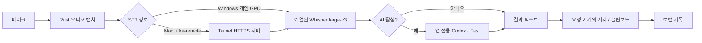

# Ultra STT — 기능·기술 사양

**기준:** 개인 데스크톱 버전 1.1.62 · 2026-10-02

**저장소:** [toughCSB/ultra-stt](https://github.com/toughCSB/ultra-stt) · 비공개

**안내:** [English](../README.md) · [한국어](../README_ko.md) · [검증](VALIDATION.md)

## 1. 제품 범위

Ultra STT는 전역 단축키로 음성을 녹음하고, STT와 선택형 LLM 처리를 거쳐 현재 입력창에 결과를 넣는 Tauri 데스크톱 앱이다. 개인 운영 구성은 Windows GPU 서버와 Mac 클라이언트이며, 자체 유료 cloud 서비스나 새로운 AI 모델을 제공하는 프로젝트는 아니다.

| 대상 | 현재 제공·검증 범위 |
| --- | --- |
| Windows x64 | 개인 CUDA 전사·Codex 다듬기·커서 출력, 설치 helper와 NSIS 설치본 |
| macOS arm64 | 마이크 녹음, 개인 서버 요청, 모드 선택, 커서 출력, 앱 번들 설치 |
| macOS Intel | 기반 Tauri 코드가 있으나 이번 버전의 빌드·설치 검증 없음 |
| Linux | 기반 코드가 있으나 이번 개인 버전의 검증·배포 대상 아님 |
| Android | 기존 키보드 유지·작은 음성 버튼·반원 드래그·5색 모드·녹음/처리 애니메이션. 1.1.62-android.5의 앱 테스트 입력창에서 사용자가 실제 한국어 음성→커서 성공 확인. 모든 외부 편집기 호환성은 별도. [설치·범위](../android/README.md) |
| iOS·모바일 웹 | Tailnet 브라우저 녹음·결과 복사·공유. iOS 네이티브 키보드는 미구현 |

일부 기반 cloud·provider 기능은 소스에 남아 있지만 개인 배포의 계정·서비스·지원 보장과 동일하지 않다.

## 2. 사용자 기능

### 음성 입력과 출력

- 받아쓰기·Ask·번역 단축키를 별도로 설정하고 작업마다 최대 세 개의 바인딩을 관리한다.
- 누른 채 말하기 또는 토글로 녹음한다. 마이크 선택과 준비·녹음·처리 상태를 제공한다.
- 키보드 시뮬레이션, 클립보드 붙여넣기, 복사 전용 출력을 지원한다.
- 녹음 시작 시의 대상 앱과 출력 시의 대상 앱을 비교한다. 대상이 바뀌거나 권한·출력에 문제가 있으면 잘못된 앱에 입력하는 대신 클립보드 fallback과 경고를 제공한다.
- Mac 자동 붙여넣기는 앱에서 Command+V를 보내며, 별도의 System Events Automation 권한을 요구하는 경로로 대체하지 않는다.

모든 앱·입력칸에 무조건 입력된다는 보장은 아니다. OS 권한, 보호된 입력칸, 다른 권한 수준의 앱, 포커스 변경을 확인해야 한다.

### 다듬기 스타일과 우선순위

| 식별자 | 목적 |
| --- | --- |
| `original` | 원래 단어·순서·말투·강조·기존 레이아웃 유지. 명백한 오인식·오타·군더더기만 정리 |
| `minimal` | 최소한의 문장부호·문장 구분과 filler 정리 |
| `clean` | 자연스러운 표현으로 가볍게 정리 |
| `structured` | 복수 항목을 목록·주제로 구조화 |
| `professional` | 간결한 업무 표현으로 정돈 |

Original의 일반 받아쓰기는 앱별 자동 문체 적용을 억제한다. 안전·사실 보존·언어·출력 규칙이 스타일보다 우선하며, 선택 텍스트 편집·번역·명시적 작업에는 해당 작업 지침이 적용된다. 실제 프롬프트는 `src-tauri/src/llm/prompt.rs`와 앱 전용 `src-tauri/resources/codex-app-instructions.md`에 있다.

스타일 선택과 AI 활성 여부는 다른 설정이다. AI를 끄면 다듬기 호출을 생략하지만 STT 자체의 오류가 자동으로 모두 수정되는 것은 아니다.

### 빠른 전환과 실행창

- 트레이 우클릭 메뉴의 체크 항목, 홈 이미지 radio 버튼, 캡슐의 모드 picker를 제공한다.
- 현재 모드는 체크·초록색 강조로 구분하며 변경 사항을 저장·방송하여 화면 사이에 동기화한다.
- 빠른 전환은 모드·활성 여부만 갱신한다. 다른 설정의 편집 중 draft를 덮어쓰지 않는다.
- 녹음 중 선택은 종료 시 확정한다. 처리 중 선택 변경은 이미 시작한 요청을 바꾸지 않는다.
- picker는 모니터 작업 영역 안에 놓고 닫으면 기존 캡슐 위치를 복원한다. 선택 중에만 포커스를 받을 수 있게 한다.
- Esc 또는 화면의 Esc 버튼으로 받아쓰기·Ask를 취소한다. 오래된 요청의 완료가 새 세션 결과로 나타나지 않도록 세션을 구분한다.
- 캡슐의 바깥 사각형 테두리·그림자를 제거하고 투명 배경과 진한 녹색 본체를 사용한다.
- Windows 트레이 왼쪽 클릭은 메인 창 열기·숨기기를 토글한다. 작업표시줄·트레이는 검정 바탕 녹색 마이크 아이콘을 사용하며 전파 무늬는 없다.

### 기록과 재사용

- 원시 전사·최종 문장·컨텍스트로 검색하고 날짜별로 필터한다.
- 최종 문장을 복사하고, 기록에서 반복되는 오류의 교정 규칙을 만들 수 있다.
- 전체 기록 비우기는 확인 단계를 거친다. 이 문서 작성 과정에서 사용자 기록을 비우거나 예시 기록을 삽입하지 않았다.
- Home의 14일 그래프는 현재 불러온 최대 200건에서 계산한 날짜별 건수다. 전체 DB 통계나 음량계가 아니다.
- 마지막 처리 시간은 실행 세션의 마지막 작업 기준이며 녹음 시간을 제외한다. 일반 경로는 STT·AI·전체 시간을, 개인 원격 경로는 통합 원격 처리·전체 시간을 표시한다.

### 추가 작업

선택 텍스트 수정·요약·번역, Ask의 단발성 음성 질문·답변 메모, 대상 언어 선택, 로컬 사전·교정 규칙, 씬, 앱별 문체 매핑, import/export, 테마와 자동 시작을 지원한다. 해당 기능은 구성한 STT·LLM 경로의 지원과 인증이 필요하다.

## 3. 처리 구조

| 구성 | 상세 |
| --- | --- |
| Frontend | React 19, TypeScript 5.8, Vite 8, Tailwind 4, Zustand 5, i18next |
| Desktop | Tauri 2.11.2, Rust 2021, `cpal`, Tokio, reqwest |
| Storage | SQLite 기록·사전, tauri-plugin-store 설정, OS vault 연동 |
| GPU runtime | Python 3.11, faster-whisper 1.2.1, CTranslate2 4.8.1, CUDA float16, beam size 5, VAD |
| STT model | 별도 준비한 `Systran/faster-whisper-large-v3` 모델 디렉터리 |
| AI adapter | Windows native Codex CLI, `gpt-6-luna`, ChatGPT 구독 인증 |
| App identity | `com.ultrastt.personal`; 개인 Mac 빌드는 안정적인 ad-hoc 지정 서명 |

개인 Python 서비스는 `127.0.0.1:17845`의 로컬 프로세스다. 원격 요청용 앱 listener는 `127.0.0.1:17846`이고 Tailnet HTTPS helper는 `10443`을 사용한다. 공유 네트워크에 Python 서비스를 직접 노출하는 구성이 아니다.

## 4. Codex 프로필·성능 정책

앱은 공식 CLI 실행 파일을 공유하고 자식 프로세스에만 앱 전용 `CODEX_HOME`을 지정한다. 개발 대화·개발 지침·개발 홈의 Skills/MCP/hooks/memories를 복사하지 않는다. 별도 공식 로그인으로 인증하며 실패 시 개발 프로필이나 유료 API로 몰래 fallback하지 않는다.

요청에는 `--ignore-user-config`, `--ephemeral`, read-only sandbox, 앱 전용 모델 지침을 사용한다. shell·browser·computer use·plugins 등 도구 기능을 차단하고 프로젝트 문서와 스킬 목록 주입도 제외한다. Codex 자체의 내부 cache/DB가 생성될 수 있으므로 ephemeral이 모든 런타임 파일을 없애는 의미는 아니다.

모든 Codex 어댑터 요청은 **Fast (`service_tier="priority"`)**다. Medium 조건은 일반 받아쓰기, 1,024자 이하, Original/Minimal/Clean, 선택 텍스트 없음, 번역 없음, 씬·사용자 prompt 없음, 사전 없음, 활성 교정 규칙 없음이다. 나머지는 High이며 Ask·번역·선택 편집도 High를 유지한다.

모델 변경, 품질 저하, 항상 켜진 마이크, 녹음 중 외부 AI 선전송을 이번 최적화에 조용히 도입하지 않았다. 모델 예열·연결 재사용·불필요한 재다듬기 제거와 지침 축소를 적용했다. 실제 지연과 한계는 [검증 문서](VALIDATION.md)에 있다.

## 5. Mac 개인 원격 요청

녹음은 Mac에서, STT·AI는 Windows에서, 삽입은 Mac에서 수행한다. 기존 Bearer 인증과 JSON 응답을 유지하고 선택 헤더만 추가했다.

| 선택 헤더 | 허용 값 | 누락 시 |
| --- | --- | --- |
| `x-ultra-stt-polish-style` | `original`, `minimal`, `clean`, `structured`, `professional` | `clean` |
| `x-ultra-stt-polish-enabled` | `true`, `false` | `true` |

잘못된 값·중복 헤더는 HTTP 400이다. 다른 STT 제공자에는 이 헤더를 보내지 않는다. `false`는 서버 Codex 처리를 생략한다. 클라이언트 연결이 끊기면 서버도 해당 작업을 취소한다. Mac은 받은 결과를 다시 로컬 AI에 보내지 않고 출력·기록 경로로 보낸다.

**전달 범위의 한계:** 이 두 헤더는 Mac의 모든 작성 설정을 동기화하는 API가 아니다. 선택 텍스트, 번역 작업, 사용자 씬·사전·교정 설정을 일반 원격 요청으로 전달한다고 가정하면 안 된다. 서버 설정과 해당 경로의 실제 지원 범위를 확인해야 한다. 모바일 브라우저 화면도 데스크톱의 다섯 모드 선택 UI와 동일하다고 주장하지 않는다.

## 6. 운영·개발 안내

- Node 요구사항: Vite 8의 `^20.19.0 || >=22.12.0`; Rust 최소 1.87.
- 모델·Python 환경·CUDA·Codex 인증은 별도 준비한다. 준비된 개인 환경을 재사용하는 build helper를 범용 one-click bootstrap으로 설명하지 않는다.
- Mac 마이크·손쉬운 사용 권한은 사용자가 허용한다. 개인 서명은 Apple notarization이나 공개 배포 인증이 아니다.
- Windows helper와 Mac helper는 이전 앱을 백업하고 설정·DB를 보존한다.
- provider keys/auth/DB/model/runtime/logs는 저장소에 게시하지 않는다.

소스 디렉터리: `src/`(UI), `src-tauri/src/`(native pipeline), `local_stt/`(GPU runtime), `remote/`(브라우저 recorder), `scripts/`(개인 build/setup helpers). [Windows](windows-personal.md), [Mac](macos-personal.md), [원격](../remote/README.md), [Codex 분리](codex-isolation-personal.md)를 참고한다.
